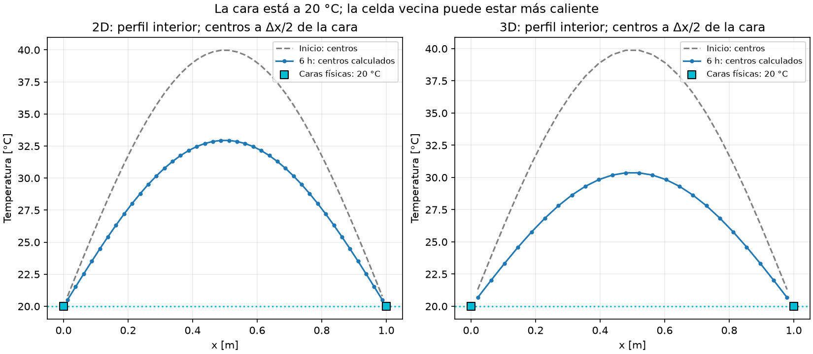
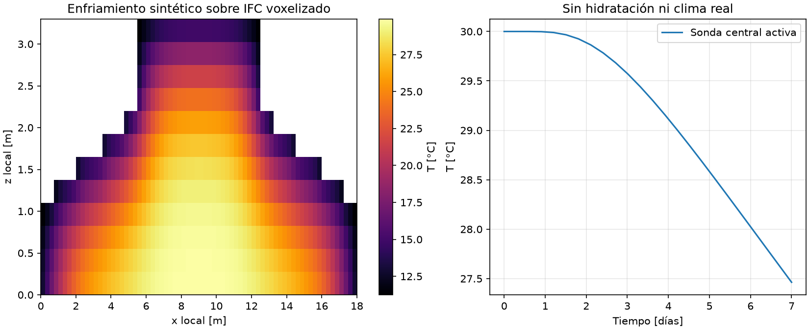

# Proyecto 2 MCOC · Grupo 8

Proyecto de Métodos Computacionales de la Universidad de los Andes, aplicado al
caso docente del Parque Eólico Cuatro Vientos, Llanquihue, Los Lagos.

El repositorio contiene un modelo BIM/IFC de la fundación, solvers térmicos
propios en 1D, 2D y 3D, voxelización del IFC y visualización de temperaturas.

```text
Bonsai / Blender → IFC guardado → IfcOpenShell → grilla cartesiana → solver térmico → resultados
```

**Los parámetros y resultados térmicos de los ensayos son sintéticos de
verificación.** La geometría es una reconstrucción docente del dibujo acotado
conservado en [docs/foundation_dimensions.png](docs/foundation_dimensions.png).
Las fuentes, unidades y parámetros acompañan a los resultados JSON.

## Visor HTML portátil

Abrir [visor_termico.html](visor_termico.html) con doble clic en un navegador
moderno. Para compartirlo, basta copiar ese archivo: incluye la geometría y el
cálculo local, sin instalar Python ni usar un servidor o Internet.

Permite cambiar parámetros, calcular temperaturas, girar el modelo 3D, abrir
cortes, recorrer el tiempo y consultar gráficos en 1D, 2D y 3D. Los ensayos son
sintéticos. La geometría incluida corresponde al IFC al generar el HTML.

Después de guardar cambios en el IFC, regenerar el archivo para compartirlos:

```cmd
.venv\Scripts\python.exe -m scripts.build_dashboard
```

La versión opcional conectada al Python y al IFC local se abre con
`.venv\Scripts\python.exe -m scripts.serve_dashboard --open`.
Ver [instrucciones del visor](docs/VISOR_HTML.md).

## Instalación

Entorno de referencia: **Python 3.12.7, Windows x64**. Desde la raíz del
repositorio, ejecutar en CMD:

```cmd
python -m venv .venv
.venv\Scripts\python.exe -m pip install -r requirements.txt
.venv\Scripts\python.exe -m pip check
```

`requirements.txt` fija las versiones de las dependencias. Los comandos usan
el Python del entorno directamente, sin necesidad de activarlo. Blender y
Bonsai se utilizan para editar el IFC; los cálculos se ejecutan en Python externo.

## Modelo BIM del caso base

El archivo [models/g8_base.ifc](models/g8_base.ifc) utiliza IFC4 y contiene tres
objetos `IfcFooting`, con identidad, GUID, material y propiedades.

| Identificador | Componente | Geometría / intervalo vertical |
|---|---|---|
| `G8-BASE-01` | Zócalo octagonal | Envolvente de 18 × 18 m; z = 0–1.10 m |
| `G8-BASE-02` | Transición inclinada | Interpolación radial triangulada del octágono al círculo; z = 1.10–2.20 m |
| `G8-BASE-03` | Cilindro superior | Diámetro 7 m; z = 2.20–3.30 m |

La altura nominal es **3.30 m**. La triangulación IFC obtiene un volumen de
aproximadamente **487.3502 m³**. La inspección valida el esquema, reglas EXPRESS,
dimensiones, volúmenes, posiciones y propiedades.

```cmd
.venv\Scripts\python.exe -m scripts.inspect_ifc
.venv\Scripts\python.exe -m scripts.preview_ifc
```


## Ejecutar el solver 1D

```cmd
.venv\Scripts\python.exe -m scripts.run_case
```

El caso [config/case_g8.json](config/case_g8.json) resuelve un perfil vertical:

| Parámetro de verificación | Valor nominal |
|---|---:|
| Longitud | 3.30 m |
| Conductividad k | 2.2 W/(m·K) |
| Densidad ρ | 2400 kg/m³ |
| Calor específico cp | 900 J/(kg·K) |
| Nodos / separación | 67 / 0.05 m |
| Paso temporal | 600 s |
| Duración | 14 días |
| Dirichlet inferior y superior | 20 °C |
| Perfil inicial | 20 + 20 sen(πz/L) °C |

La referencia exacta es:

```text
T(z,t) = 20 + 20 sen(πz/L) exp[−α(π/L)²t], con α = k/(ρcp)
```

Los perfiles, historias, figuras y resumen se exportan a `results/example_1d/`.
El solver es nodal: incluye nodos en las superficies y medias celdas de control
en los extremos Neumann/Robin.

### Entradas desde IFC y JSON

El caso principal toma **la altura real de la geometría IFC** y las propiedades
comunes `Conductivity_W_mK`, `Density_kg_m3` y `SpecificHeat_J_kgK` del conjunto
`MCOC_Thermal1D`, asociado a `G8-BASE-03`. Esas propiedades representan el
material homogéneo común del caso térmico. Los GUID identifican los componentes.

En el JSON se modifican los bordes `bottom` y `top`, condición inicial, fuente,
`thermal.nodes`, `thermal.dt_s` y duración. La separación es `Δz = L/(nodes−1)`.
La altura y propiedades importadas del IFC tienen prioridad sobre esos mismos
campos del JSON y sobre `--set`.

```cmd
.venv\Scripts\python.exe -m scripts.run_case --set thermal.dt_s=300 --output results/lab_dt
.venv\Scripts\python.exe -m scripts.run_case --set thermal.nodes=133 --set thermal.dt_s=150 --output results/lab_malla
.venv\Scripts\python.exe -m scripts.run_case --no-ifc --set thermal.conductivity_w_mk=1.5 --output results/lab_json
```

`--set` aplica cambios a una ejecución. `--no-ifc` utiliza exclusivamente las
entradas JSON. Los casos de [config/ejemplos](config/ejemplos/) incluyen ensayos
Dirichlet, Neumann, Robin y fuente volumétrica.

El procedimiento de edición y lectura está en [IFC → solver 1D](docs/IFC_SOLVER_1D.md).
`scripts.create_ifc` regenera el modelo nominal; para calcular sobre una edición
Bonsai, guardar el IFC y ejecutar el lector/solver sobre ese archivo.

## Solver cartesiano 2D/3D

[thermal3d/solver.py](thermal3d/solver.py) utiliza **volúmenes finitos centrados
en celdas**, espaciamientos distintos por eje y Euler explícito:

```text
C_i (T_i^{n+1} − T_i^n)/Δt = Σ G_ij(T_j^n − T_i^n) + q̇(t_n)V_i + Q_borde,i(t_n)
C_i = ρ_i cp_i V_i
G_ij = k A/d, con media armónica de k entre materiales distintos
```

Los centros se ubican en `(i + 0.5)Δ`, con `Δ = L/n`. En 2D se usa profundidad
unitaria. La máscara booleana `active` selecciona las celdas participantes.
Las interfaces activa/inactiva son adiabáticas por defecto; `exposed` permite
asignarles una condición explícita.

Se admiten materiales escalares o campos por celda. Las conductancias se
precalculan y los flujos internos se intercambian con signos opuestos mediante
slicing. La fuente y el ambiente variable se evalúan al inicio de cada paso.
El último paso se acorta; `save_every` conserva inicial, estados solicitados y
final. Se registran energía y aportes acumulados de bordes y fuente.

Se comprueban los límites general y local:

```text
α Δt Σ(1/Δa²) ≤ 1/2
Δt ≤ min_i [C_i / (Σ G_ij + G_borde,i)]
```

Con materiales variables, el límite general usa la máxima difusividad activa.

## Condiciones de borde y cómo observarlas

| Condición | Significado e implementación |
|---|---|
| Dirichlet | Temperatura de la cara impuesta; en celdas centradas, G = kA/(Δ/2) |
| Neumann | Flujo entrante q_in; potencia q_in A; cero es adiabático |
| Robin | Convección y conducción de media celda en serie: G = [1/(hA) + (Δ/2)/(kA)]⁻¹ |

El flujo positivo entra al dominio. `effective_h` permite sumar resistencias
superficiales de ensayo en serie con la película convectiva.

Los ejemplos utilizan las siguientes condiciones:

| Caso | Bordes |
|---|---|
| Verificación 1D principal | Dirichlet 20 °C en ambos extremos |
| Visor de ensayos 2D/3D | Dirichlet 20 °C en cuatro / seis caras |
| Batería matemática sinusoidal `verify_3d` | Dirichlet 0 °C como referencia del ensayo |
| Demo de la fundación 3D | Robin: aire nominal 10 °C y h = 10 W/(m²·K); base adiabática |

En 1D, los nodos extremos muestran la temperatura prescrita. En 2D/3D, el
centro de la primera celda está a media celda de la cara: **la cara puede estar
a 20 °C mientras el centro vecino está más caliente**. Robin, por su parte,
no fija la superficie a la temperatura del aire.

## Ver las soluciones de temperatura

```cmd
.venv\Scripts\python.exe -m scripts.view_solutions --show
```

Abre el mapa inicial/final 2D, cortes interiores 3D, una vista giratoria y
perfiles que distinguen caras impuestas de centros calculados. Arrastrar con
el ratón gira la vista 3D. Sin `--show`, las figuras se guardan en
`results/soluciones/`; los campos numéricos de los ensayos se exportan en NPZ.



En esta figura, los cuadrados cian son datos de borde y las curvas son valores
en centros. Los parámetros y valores de esos perfiles están en
[condiciones_borde.json](results/soluciones/condiciones_borde.json).

## Voxelizar el IFC y calcular la fundación en 3D

```cmd
.venv\Scripts\python.exe -m scripts.voxelize_foundation
.venv\Scripts\python.exe -m scripts.foundation_3d_demo
.venv\Scripts\python.exe -m scripts.view_solutions --case fundacion --show
```

El voxelizador lee los triángulos del **IFC guardado**, en coordenadas globales
SI; clasifica centros y registra componentes, origen, espaciamientos efectivos,
GUID y SHA-256. El estudio de volumen usa cuatro resoluciones y compara con la
triangulación IFC. Los componentes son identificadores geométricos.

La demo térmica consume esa máscara y las propiedades comunes del enlace IFC.
En el ensayo nominal, la temperatura inicial es 30 °C y la duración es siete
días. La grilla contiene **28184 celdas activas**; la sonda central activa llega
a **27.462812 °C**, con residuo relativo de balance **7.291569e-16**.



Los cortes muestran el interior del cálculo 3D. La vista giratoria muestra
las celdas superficiales coloreadas por temperatura. La sonda se identifica
por índice y coordenadas en el JSON de resultados.

Para utilizar una copia modificada en Bonsai:

```cmd
.venv\Scripts\python.exe -m scripts.voxelize_foundation --ifc results/lab/edited.ifc --output results/lab_voxel
.venv\Scripts\python.exe -m scripts.foundation_3d_demo --ifc results/lab/edited.ifc --output results/lab_termica
.venv\Scripts\python.exe -m scripts.view_solutions --case fundacion --input results/lab_termica/temperatura_final.npz --output results/lab_vista --show
```

Los cambios se leen después de **Save IFC Project**. La voxelización obtiene la
geometría del IFC, no de las cotas nominales del JSON.

Para ensayar otras condiciones de intercambio o resoluciones:

```cmd
.venv\Scripts\python.exe -m scripts.foundation_3d_demo --set h_w_m2k=20 --set air_c=0 --output results/lab_frio
.venv\Scripts\python.exe -m scripts.foundation_3d_demo --set insulation_resistance_m2k_w=0.5 --output results/lab_aislado
.venv\Scripts\python.exe -m scripts.foundation_3d_demo --set dx_m=0.125 --set dz_m=0.1375 --output results/lab_fino
```

## Pruebas y resultados reproducibles

**Verificación del 28 de octubre de 2026: 175 pruebas aprobadas en 115.05 s.**

```cmd
.venv\Scripts\python.exe -m pytest -q
.venv\Scripts\python.exe -m scripts.verify_3d
.venv\Scripts\python.exe -m scripts.verify
.venv\Scripts\python.exe -m scripts.convergence
.venv\Scripts\python.exe -m scripts.convergence_nd
```

Las pruebas cubren soluciones sinusoidales exactas, conservación de energía,
fuentes constantes y variables, flujos Neumann, Robin, materiales distintos,
máscaras, estabilidad, ausencia de periodicidad y guardado selectivo. También
comprueban cambios guardados del IFC, conversión de unidades, voxelización y
la diferencia entre temperaturas prescritas en caras y calculadas en centros.
El visor portátil se contrasta con los solvers Python en los cuatro modos,
incluyendo las tres condiciones de borde, fuentes y balance de energía.

| Verificación registrada | Resultado |
|---|---|
| Orden espacial 1D | 2.00078 |
| Orden temporal 1D | 1.00039 |
| Orden espacial 2D | 1.97289 → 1.99325 |
| Orden espacial 3D | 1.96099 → 1.99029 |
| Robin transitorio frente a 1D fino | Orden 1.87564 → 1.95142 |
| Orden temporal 2D | 1.00405 → 1.00101 |
| Orden temporal 3D | 1.00556 → 1.00138 |
| Conservación adiabática, fuentes y Neumann | Errores relativos inferiores a 1e-12 |
| Error volumétrico en la resolución más fina del estudio IFC | 0.0314 % |

El error de volumen no disminuye en cada refinamiento; la tabla registra el
valor de la resolución más fina. Los estudios espaciales y temporales tienen
sus propios casos, mallas y referencias declarados en los archivos de salida.

| Carpeta | Contenido |
|---|---|
| `results/example_1d/` | Perfiles, historia y solución exacta 1D |
| `results/convergence/` | Convergencia espacial/temporal 1D |
| `results/verification_3d/` | Batería base 2D/3D y convergencia espacial |
| `results/verification/` | Matriz adicional, dos materiales y balance energético |
| `results/convergence_nd/` | Convergencia temporal contra la solución semidiscreta |
| `results/voxel/` | Volúmenes, grilla IFC, campo térmico final y demostración |
| `results/soluciones/` | Mapas, vistas 3D, perfiles de borde y campos NPZ |

## Organización y documentación

| Ruta | Función |
|---|---|
| `thermal1d/` | Solver nodal, casos JSON, referencias y enlace IFC |
| `thermal3d/solver.py` | Balance centrado en celdas, bordes y materiales |
| `thermal3d/voxel.py` | Lectura de mallas IFC y clasificación cartesiana |
| `thermal3d/reference.py` | Referencias continuas, semidiscretas y de dos capas |
| `thermal3d/verification.py` | Experimentos de la batería base |
| `thermal3d/extra_verification.py` | Ensayos de materiales y superficies expuestas |
| `scripts/` | Ejecución, inspección, estudios y visualización |
| `tests/` | Pruebas automatizadas |

- [Guía oral E04](docs/E04_guia_oral.md).
- [Formulación y verificación del solver general](docs/E04_solver_3d.md).
- [Guía de laboratorio E05](docs/E05_guia_laboratorio.md).
- [Dossier de evidencias E06](docs/E06_dossier_verificacion.md).
- [Edición IFC y enlace al solver 1D](docs/IFC_SOLVER_1D.md).
- [Guías del curso G00–G08 y difusión térmica](docs/guias/README.md).
- [Correspondencia de referencias](docs/REFERENCIAS_GUIAS.md).
- [Procedencia de las mejoras integradas](docs/INTEGRACION_ZIP_2.md).
