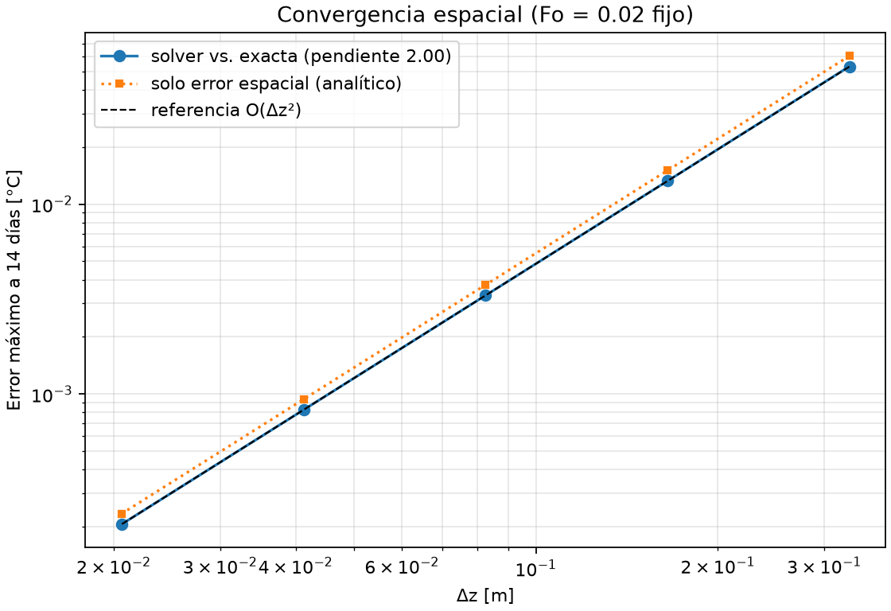
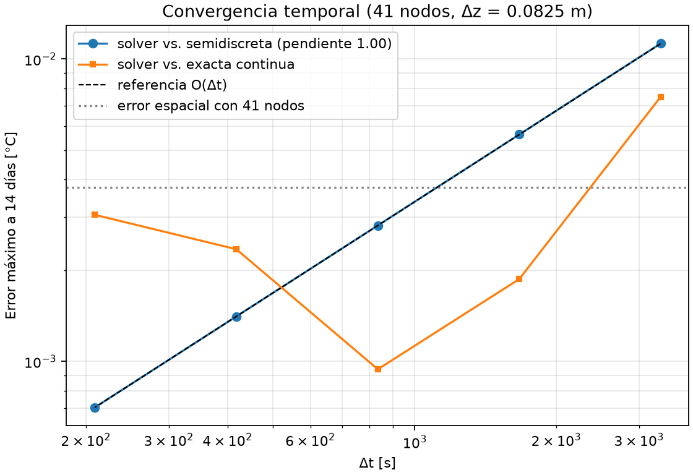

# Proyecto 2 MCOC · G8

Primera entrega: comprensión inicial de BIM/IFC y difusión térmica, con un
solver 1D propio, un caso resuelto y pruebas automatizadas.

**Estado:** referencias contrastadas con las guías G00–G08 y la guía de difusión
entregadas por el usuario. Se conservan en [docs/guias](docs/guias/README.md).
Cada integrante debe realizar su lectura individual según el encargo del curso.
Este avance no equivale al plan de construcción final.

Se incorporaron del ZIP del usuario bordes Neumann/Robin, fuente volumétrica,
casos JSON, comparación de cambios IFC y verificación espacial/temporal.
La única geometría del proyecto es la fundación reconstruida desde la imagen,
con altura total de 3,30 m.

## Caso docente y alcance

G8: Parque Eólico Cuatro Vientos, Llanquihue, Los Lagos. El punto meteorológico
asignado es **latitud -41.222539, longitud -73.295603**. Es un punto docente,
no la coordenada exacta de una fundación real. Se conserva en el JSON y en un
conjunto de propiedades del sitio IFC, sin usarlo para georreferenciar la base.

El IFC representa una fundación de **planta octagonal**, con envolvente de
**18 × 18 m**, zócalo de 1,10 m, transición inclinada de 1,10 m y cilindro superior
de **7 m de diámetro y 1,10 m de altura**. La altura total es **3,30 m**.
La figura acotada aportada por el usuario permite interpretar las dimensiones
originales en milímetros: 9000, 3728, 1750 y tres tramos verticales de 1100.
Se completa la planta por simetría respecto de los dos ejes del cuarto mostrado.
Estas son cotas del dibujo de referencia, no mediciones del emplazamiento G8.

La superficie 3D exacta de transición no queda completamente definida por la
planta y una sección. Se adopta una **interpolación radial triangulada entre el
octágono inferior y el círculo superior**, con 16 subdivisiones por lado del
octágono (128 en el contorno superior). Es una aproximación docente documentada,
pendiente de confirmar con el modelo oficial. El cilindro usa un perfil circular
IFC exacto; las mediciones y vistas desde IfcOpenShell triangulan sus curvas.


El volumen anterior de 1069,2 m³ correspondía al prisma cuadrado simplificado y
ya no aplica. La inspección actual obtiene aproximadamente **487,35 m³** mediante
triangulación, para la reconstrucción y aproximación de transición adoptadas.
La [figura acotada de referencia](docs/foundation_dimensions.png) se conserva
para revisar las cotas y los supuestos.

El solver representa un perfil vertical de 3,30 m con sección constante y
temperatura uniforme en cada plano horizontal. Desprecia los flujos laterales.
El caso principal **lee automáticamente la altura guardada en el IFC** y las
propiedades térmicas comunes de `MCOC_Thermal1D`, en el cilindro `G8-BASE-03`.
El adaptador prepara los valores y el solver sigue siendo Python independiente
de Blender. El JSON conserva bordes, condición inicial, malla y tiempo.

La conexión usa los GUID configurados: los nombres se pueden modificar. La
altura se calcula desde la geometría en coordenadas globales, no desde la
propiedad informativa `Height_m`. El origen del perfil térmico es relativo a la
base de la envolvente. No se incorporan secciones variables ni pérdidas laterales.

## Instalación reproducible

Entorno probado: **Python 3.12.7, Windows x64**. Instalar esa versión de Python.
Desde la raíz del repositorio, en PowerShell:

```powershell
python -m venv .venv
.\.venv\Scripts\python.exe -m pip install -r requirements.txt
.\.venv\Scripts\python.exe -m pip check
```

No es necesario activar el ambiente. `requirements.txt` fija dependencias
directas y transitivas. Blender/Bonsai es una herramienta externa y no se
instala con pip. En otros sistemas, usar `.venv/bin/python`; su instalación
no se ha verificado en este avance.

## Ejecutar y comprobar

```powershell
# Ejecutar el ejemplo térmico y regenerar gráficos, CSV y resumen
.\.venv\Scripts\python.exe -m scripts.run_case

# Regenerar el IFC y comprobar esquema, propiedades y geometría
.\.venv\Scripts\python.exe -m scripts.create_ifc
.\.venv\Scripts\python.exe -m scripts.inspect_ifc --output results/ifc_validation.json
.\.venv\Scripts\python.exe -m scripts.preview_ifc

# Ejecutar todas las pruebas
.\.venv\Scripts\python.exe -m pytest -q
```

Los comandos se ejecutan desde la raíz. Para otro caso o carpeta de salida:

```powershell
.\.venv\Scripts\python.exe -m scripts.run_case --config config/case_g8.json --output results/example_1d
```

Para probar otros bordes y modificar parámetros sin editar el archivo:

```powershell
.\.venv\Scripts\python.exe -m scripts.run_case --output results/lab_dt --set thermal.dt_s=300
.\.venv\Scripts\python.exe -m scripts.run_case --config config/ejemplos/plantilla_hormigon.json --output results/lab_robin --set top.h_w_m2k=20
.\.venv\Scripts\python.exe -m scripts.convergence
```

`--set` aplica cambios solo a esa ejecución. `--allow-unstable` es un modo de
demostración que desactiva el rechazo de pasos inestables; sus resultados se
marcan como inválidos para interpretación física. Las carpetas `results/lab*`
se excluyen de Git para preservar las demostraciones como archivos locales.

### Del IFC guardado al solver, automáticamente

Tras editar y guardar el IFC desde Bonsai, ejecutar normalmente:

```cmd
.venv\Scripts\python.exe -m scripts.run_case --output results/lab_ifc
```

Para una copia editada, indicar ese archivo:

```cmd
.venv\Scripts\python.exe -m scripts.run_case --ifc results/lab/edited.ifc --output results/lab_ifc_editado
```

En el caso principal, el IFC tiene prioridad sobre `thermal.length_m`,
`conductivity_w_mk`, `density_kg_m3` y `specific_heat_j_kgk` del JSON o `--set`.
Los valores efectivos, GUID y SHA-256 del archivo quedan en `summary.json`.
El lector no modifica el JSON ni el IFC. Si no encuentra datos válidos,
interrumpe la ejecución; no usa silenciosamente los valores anteriores.

Para trabajar exclusivamente con el JSON, por ejemplo un ensayo de longitud:

```cmd
.venv\Scripts\python.exe -m scripts.run_case --no-ifc --set thermal.length_m=4 --output results/lab_json
```

Los casos de `config/ejemplos` siguen usando solo JSON salvo que se indique un IFC.
Las rutas `ifc.path` del JSON son relativas a ese archivo; `--ifc` es relativa al
directorio actual. La importación se limita a sólidos apilados sin huecos ni
solapamientos verticales y con una zona XY común en sus envolventes.

No ejecutar `scripts.create_ifc` para simular un archivo editado: ese comando
**regenera** la geometría nominal y puede reemplazar la edición. Véase
[el procedimiento y los campos de Bonsai](docs/IFC_SOLVER_1D.md).

## Física y método

Difusión pura con conductividad `k`, densidad `ρ` y calor específico `cp`
constantes y sin fuente interna en el caso base:

```text
ρ cp ∂T/∂t = k ∂²T/∂z²
α = k / (ρ cp)
T_i^(n+1) = T_i^n + Fo (T_(i+1)^n - 2 T_i^n + T_(i-1)^n)
Fo = α Δt / Δz² ≤ 1/2
```

La ecuación expresa almacenamiento de energía e intercambio por conducción.
Se usan diferencias centrales en el espacio y Euler explícito en el tiempo.
La restricción indicada aplica a este caso 1D uniforme con bordes Dirichlet.
El solver admite además una fuente volumétrica uniforme `source_w_m3` [W/m³]
y tres tipos de borde, definidos por separado en `bottom` y `top` del JSON:

| Tipo | Configuración | Significado |
|---|---|---|
| Dirichlet | `{"type":"dirichlet","temperature_c":20}` | Temperatura impuesta |
| Neumann | `{"type":"neumann","flux_in_w_m2":0}` | Flujo entrante impuesto; cero es adiabático |
| Robin | `{"type":"robin","h_w_m2k":12,"ambient_c":10}` | Flujo entrante `h (T_amb - T_borde)` |

Para Neumann/Robin se usan volúmenes de control de media celda en los extremos.
Robin exige también `Fo (1 + Bi) ≤ 1/2`, con `Bi = h Δz/k`; el programa calcula
el límite más restrictivo. El ambiente puede ser constante o sinusoidal; no es
una descarga de clima real. La fuente uniforme no es una ley de hidratación calibrada.

Por defecto el solver rechaza pasos inestables y acorta el último paso para
alcanzar el tiempo solicitado. `save_every` permite reducir el historial
guardado. La exportación limita los instantes para corridas extensas y declara
que las métricas corresponden a esos instantes. En el caso base se guardan todos.
Dirichlet impone los extremos desde el instante inicial, sin cambiar el interior.

### Ejemplo resuelto: verificación matemática

Todos los valores térmicos siguientes son **sintéticos**, elegidos para probar
el código. No son mediciones, propiedades verificadas de una mezcla ni clima G8.

| Entrada | Valor |
|---|---:|
| Longitud vertical | 3,30 m |
| Conductividad | 2,2 W/(m·K) |
| Densidad | 2400 kg/m³ |
| Calor específico | 900 J/(kg·K) |
| Nodos / separación | 67 / 0,05 m |
| Paso temporal | 600 s |
| Duración | 14 días |
| Temperaturas prescritas en ambos extremos | 20 °C |
| Perfil inicial | 20 + 20 sen(πz/L) °C |

La solución exacta que sirve de referencia independiente es:

```text
T(z,t) = 20 + 20 sen(πz/L) exp[-α (π/L)² t]
```

El núcleo inicialmente más caliente se enfría hacia los extremos prescritos.
La versión general de la referencia admite temperaturas distintas en los extremos
mediante un perfil lineal estacionario más el mismo modo seno.


`results/example_1d/summary.json` contiene el error máximo y RMSE final,
la temperatura final del centro y los parámetros utilizados. `profiles.csv`
compara solver y solución exacta en cinco instantes. `history.csv` contiene
la evolución de cuatro puntos. Estos archivos se regeneran con el comando anterior.

Las pruebas comprueban temperatura uniforme, equilibrio lineal con extremos
distintos, solución exacta, reducción del error espacial, límites del campo,
tiempo final y entradas inválidas. También verifican energía adiabática, flujo
impuesto, bordes Robin, fuente uniforme y el IFC de 3,30 m.

### Convergencia espacial y temporal

`scripts.convergence` genera CSV, figuras y resumen en `results/convergence`.
La prueba espacial refina 11 a 161 nodos con Fo pequeño y fijo; se espera orden 2.
La temporal mantiene 41 nodos y compara con la solución exacta semidiscreta para
aislar el error de Euler explícito; se espera orden 1.





Los órdenes obtenidos se guardan en `results/convergence/resumen.json`.
La explicación está en [la preparación de E03](docs/E03_verificacion_1d.md).

## BIM / IFC

BIM organiza geometría, identidad y propiedades. IFC es un formato abierto de
intercambio de esa información. El modelo `models/g8_base.ifc` usa IFC4 y contiene
la jerarquía proyecto–sitio–edificio–nivel y tres objetos físicos `IfcFooting`,
cada uno con nombre, identificador, GUID, material y propiedades propios.
Los scripts usan IfcOpenShell para generarlos, leerlos y validarlos.

El modelo contiene tres componentes geométricos identificables:

| Identificador | Objeto | Intervalo vertical z |
|---|---|---|
| `G8-BASE-01` | Zócalo octagonal, envolvente 18 × 18 m | 0–1,10 m |
| `G8-BASE-02` | Transición inclinada hacia el círculo superior | 1,10–2,20 m |
| `G8-BASE-03` | Cilindro superior, diámetro 7 m | 2,20–3,30 m |

Esta separación permite identificar tres sólidos en E02. No constituye un plan
de vertidas aprobado y no cambia el solver 1D. Los GUID y etiquetas de los tres
objetos se conservan respecto de la versión anterior.

La inspección comprueba el esquema y reglas EXPRESS, triangula el sólido y mide
sus dimensiones y volumen. La prueba automatizada compara estos valores con la
geometría configurada.

**Revisión visual del modelo anterior de un solo bloque, completada el 19 de
octubre de 2026** en Blender 5.2.2 LTS con Bonsai 0.9.0.post1, sobre el archivo
`g8_base.ifc` abierto en la aplicación:

- El bloque carga y se visualiza correctamente, con dimensiones de 18 × 18 × 3,30 m.
- El elemento está clasificado como `IfcFooting`, con `PredefinedType = PAD_FOOTING`.
- Tiene asignado el material «Hormigón - propiedades pendientes de validación».
- El conjunto de propiedades `MCOC_InitialModel` está presente.

La reconstrucción actual del 20 de octubre de 2026 se comprueba mediante
validación IFC y pruebas de geometría, identidad, posición, perfil circular,
volúmenes de zócalo y cilindro y cierre de la malla de transición. También se
genera una vista 3D y sección directamente desde la geometría del IFC.
Su apertura visual en Bonsai queda pendiente; se debe volver a abrir el IFC
actualizado desde disco. La revisión de Bonsai descrita arriba corresponde
únicamente a la versión anterior de un solo bloque.

La superficie definitiva de transición sigue pendiente de confirmación. Las
cotas del cilindro ya están incorporadas según la imagen y el diámetro indicado
por el usuario. La revisión visual del IFC no sustituye la verificación numérica
del solver ni el estudio formal de convergencia espacial y temporal.

### Comparar modificaciones guardadas en IFC

`scripts.inspect_ifc --output` guarda una referencia y `--compare` informa los
cambios por GUID, incluso si se renombra un objeto. Detecta propiedades,
material, posición, volumen, altas y bajas. Ignora los identificadores internos
de los property sets, que pueden cambiar al guardar. Véase el procedimiento
con una copia de trabajo en [la preparación de E02](docs/E02_guia_laboratorio.md).
Las pruebas automatizadas editan y vuelven a leer un IFC temporal; eso no
acredita todavía la demostración manual completa de esta versión en Bonsai.

## Límites y próximos pasos

Esta versión no incluye hidratación calibrada, activación por vertidas,
un modelo explícito de suelo, clima descargado, voxelización 3D ni incertidumbre. No predice el
comportamiento de la fundación real ni demuestra cumplimiento de los límites
docentes de 70 °C y 20 °C de diferencial. La evaluación posterior del diferencial
debe considerar puntos a aproximadamente 25 mm bajo la superficie.

La revisión de referencias está documentada en
[Referencias de las guías](docs/REFERENCIAS_GUIAS.md). La presentación ubica el
flujo IFC en E02 y la verificación formal con convergencia
en E03. Hay evidencia numérica local, pero no se afirma haber sido evaluados ni
haber completado la demostración manual de Bonsai.

## Estructura

```text
config/case_g8.json       Parámetros, procedencia y punto meteorológico
thermal1d/solver.py       Método numérico, bordes y balance de energía
thermal1d/reference.py    Soluciones exactas continuas y semidiscretas
thermal1d/case.py         Lectura de casos JSON y modificaciones --set
thermal1d/ifc_input.py    Lectura de altura y propiedades térmicas desde IFC
scripts/run_case.py      Ejecución y exportación de resultados
scripts/create_ifc.py    Generación reproducible del modelo inicial
scripts/foundation_geometry.py  Octágono y transición geométrica aproximada
scripts/inspect_ifc.py   Lectura y validación IFC
scripts/preview_ifc.py   Vista 3D y sección generadas desde el IFC
scripts/convergence.py   Estudios de convergencia espacial y temporal
models/g8_base.ifc       Modelo inicial
docs/foundation_dimensions.png  Dibujo acotado aportado por el usuario
docs/INTEGRACION_ZIP.md   Procedencia, decisiones y alcance de la integración
tests/                   Pruebas automatizadas
results/                 Evidencia reproducible del ejemplo
```

## Fuentes y trazabilidad

- [Guías G00–G08 y guía de difusión](docs/guias/README.md), entregadas por el usuario y revisadas para las referencias del proyecto.
- [Correspondencia entre implementación, ejemplos y guías](docs/REFERENCIAS_GUIAS.md): citas confirmadas y adaptaciones identificadas.
- [G00](docs/guias/G00_MAPA_CONCEPTUAL.md), [G01](docs/guias/G01_BIM_IFC_REVIT_OPENBIM.md), [G02](docs/guias/G02_BLENDER_BONSAI.md) y [G03](docs/guias/G03_IFCOPENSHELL_PYTHON.md): BIM/IFC, Bonsai, identidad y lectura desde Python.
- [G05](docs/guias/G05_DIFUSION_TERMICA_FD.md) y [Difusión de calor](docs/guias/DIFUSION_DE_CALOR_1D_2D_3D.md), §§2–12, 21–22, 30–33: balance, diferencias finitas, bordes, estabilidad y verificación.
- Enunciado y antecedentes del caso G8 proporcionados por el curso.
- Figura acotada de la fundación aportada por el usuario el 20 de octubre de 2026, atribuida en el contexto del curso a Ju y Lei (2019); diámetro superior de 7 m confirmado por el usuario. Se conserva en `docs/foundation_dimensions.png`.
- Presentación inicial P2 Hormigón Masivo 2026: diapositivas 4, 8, 12, 15, 26 y 31.
- Ju y Lei (2019), [Actual Temperature Evolution of Thick Raft Concrete Foundations and Cracking Risk Analysis](https://doi.org/10.1155/2019/7029671): referencia del curso para geometría aproximada. Este avance no reproduce su modelo FE ni sus mediciones.
- [Documentación oficial de IfcOpenShell](https://docs.ifcopenshell.org/ifcopenshell-python/geometry_creation.html).
- [Documentación oficial de Bonsai](https://docs.bonsaibim.org/).
