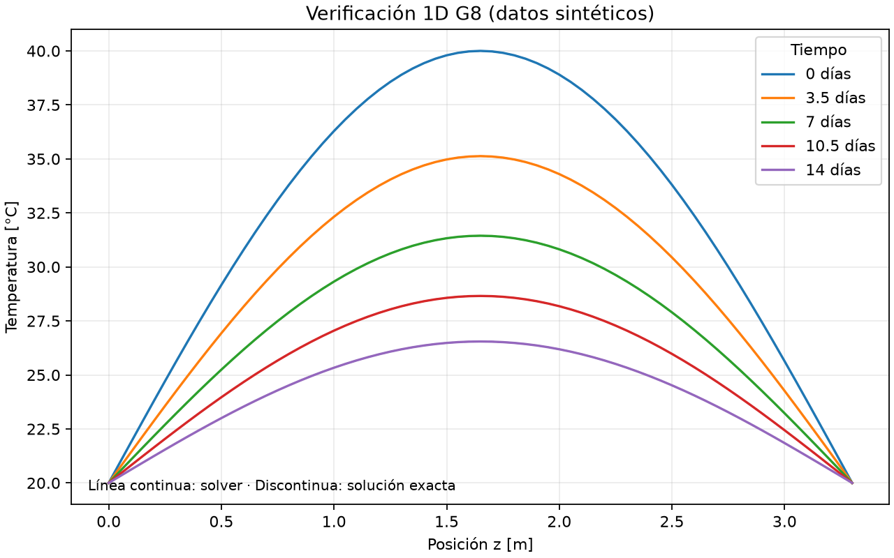
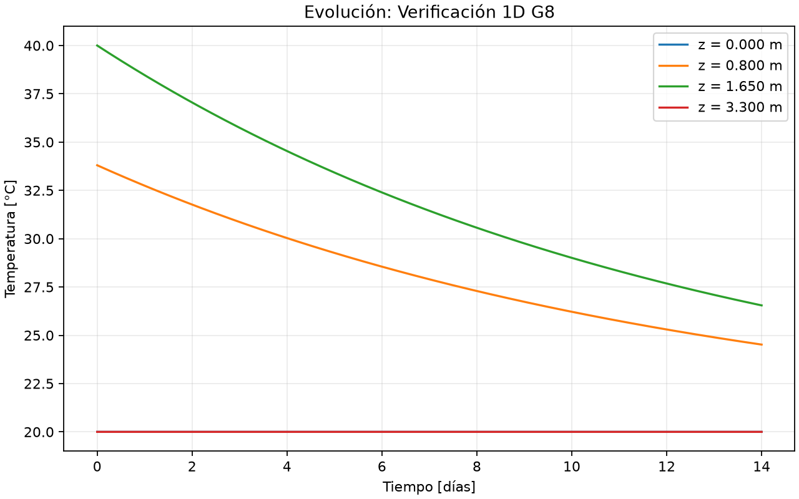

# Proyecto 2 MCOC · G8

Primera entrega: comprensión inicial de BIM/IFC y difusión térmica, con un
solver 1D propio, un caso resuelto y pruebas automatizadas.

**Estado:** base inicial adaptable a las guías G00–G05 cuando estén disponibles.
Las guías completas aún no se han revisado. Cada integrante debe leerlas según
el encargo del curso. Este avance no equivale al plan de construcción final.

## Caso docente y alcance

G8: Parque Eólico Cuatro Vientos, Llanquihue, Los Lagos. El punto meteorológico
asignado es **latitud -41.222539, longitud -73.295603**. Es un punto docente,
no la coordenada exacta de una fundación real. Se conserva en el JSON y en un
conjunto de propiedades del sitio IFC, sin usarlo para georreferenciar la base.

El IFC representa un bloque provisional de **18 × 18 × 3,30 m**, volumen
**1069,2 m³**. Son dimensiones aproximadas suministradas por el curso a partir
de Ju y Lei (2019). Falta validar la geometría oficial y la altura del cilindro
superior de aproximadamente 7 m de diámetro, que se omite en este primer modelo.

El solver representa un perfil vertical de 3,30 m con sección constante y
temperatura uniforme en cada plano horizontal. Desprecia los flujos laterales.
La geometría IFC y los parámetros térmicos se mantienen separados: el solver
lee el JSON, **todavía no extrae automáticamente su dominio del IFC**.

## Instalación reproducible

Entorno probado: **Python 3.12.7, Windows x64**. Instalar esa versión de Python.
Desde la raíz del repositorio, en PowerShell:

```powershell
python -m venv .venv
.\.venv\Scripts\python.exe -m pip install -r requirements.txt
.\.venv\Scripts\python.exe -m pip check
```

No es necesario activar el ambiente. `requirements.txt` fija dependencias
directas y transitivas. Blender/Bonsai es una herramienta externa y no se
instala con pip. En otros sistemas, usar `.venv/bin/python`; su instalación
no se ha verificado en este avance.

## Ejecutar y comprobar

```powershell
# Ejecutar el ejemplo térmico y regenerar gráficos, CSV y resumen
.\.venv\Scripts\python.exe -m scripts.run_case

# Regenerar el IFC y comprobar esquema, propiedades y geometría
.\.venv\Scripts\python.exe -m scripts.create_ifc
.\.venv\Scripts\python.exe -m scripts.inspect_ifc --output results/ifc_validation.json

# Ejecutar todas las pruebas
.\.venv\Scripts\python.exe -m pytest -q
```

Los comandos se ejecutan desde la raíz. Para otro caso o carpeta de salida:

```powershell
.\.venv\Scripts\python.exe -m scripts.run_case --config config/case_g8.json --output results/example_1d
```

## Física y método

Difusión pura con conductividad `k`, densidad `ρ` y calor específico `cp`
constantes, sin fuente interna:

```text
ρ cp ∂T/∂t = k ∂²T/∂z²
α = k / (ρ cp)
T_i^(n+1) = T_i^n + Fo (T_(i+1)^n - 2 T_i^n + T_(i-1)^n)
Fo = α Δt / Δz² ≤ 1/2
```

La ecuación expresa almacenamiento de energía e intercambio por conducción.
Se usan diferencias centrales en el espacio y Euler explícito en el tiempo.
La restricción indicada aplica a este caso 1D uniforme con bordes Dirichlet.
El solver rechaza pasos inestables y acorta el último paso para alcanzar el
tiempo solicitado. Guarda el historial completo, adecuado para casos pequeños.

### Ejemplo resuelto: verificación matemática

Todos los valores térmicos siguientes son **sintéticos**, elegidos para probar
el código. No son mediciones, propiedades verificadas de una mezcla ni clima G8.

| Entrada | Valor |
|---|---:|
| Longitud vertical | 3,30 m |
| Conductividad | 2,2 W/(m·K) |
| Densidad | 2400 kg/m³ |
| Calor específico | 900 J/(kg·K) |
| Nodos / separación | 67 / 0,05 m |
| Paso temporal | 600 s |
| Duración | 14 días |
| Temperaturas prescritas en ambos extremos | 20 °C |
| Perfil inicial | 20 + 20 sen(πz/L) °C |

La solución exacta que sirve de referencia independiente es:

```text
T(z,t) = 20 + 20 sen(πz/L) exp[-α (π/L)² t]
```

El núcleo inicialmente más caliente se enfría hacia los extremos prescritos.
La versión general de la referencia admite temperaturas distintas en los extremos
mediante un perfil lineal estacionario más el mismo modo seno.





`results/example_1d/summary.json` contiene el error máximo y RMSE final,
la temperatura final del centro y los parámetros utilizados. `profiles.csv`
compara solver y solución exacta en cinco instantes. `history.csv` contiene
la evolución de cuatro puntos. Estos archivos se regeneran con el comando anterior.

Las pruebas comprueban temperatura uniforme, equilibrio lineal con extremos
distintos, solución exacta, reducción del error espacial, límites del campo,
tiempo final y entradas inválidas. También verifican el caso publicado y el IFC.
La comprobación espacial inicial no reemplaza el estudio formal espacial y
temporal de E03.

## BIM / IFC

BIM organiza geometría, identidad y propiedades. IFC es un formato abierto de
intercambio de esa información. El modelo `models/g8_base.ifc` usa IFC4 y contiene
la jerarquía proyecto–sitio–edificio–nivel, una fundación `IfcFooting`, su GUID,
material y propiedades de la simplificación. La geometría es un prisma extruido
en metros. Los scripts usan IfcOpenShell para generarlo, leerlo y validarlo.

La inspección comprueba el esquema y reglas EXPRESS, triangula el sólido y mide
sus dimensiones y volumen. La prueba automatizada compara estos valores con la
geometría configurada. En Bonsai, cargar el IFC y revisar el elemento, dimensiones,
material y propiedades. **La apertura visual en Bonsai está pendiente**: no se
encontró Blender/Bonsai en las ubicaciones habituales del equipo.

## Límites y próximos pasos

Esta versión no incluye hidratación, activación por vertidas, intercambio Robin
con aire/suelo, clima descargado, voxelización 3D ni incertidumbre. No predice el
comportamiento de la fundación real ni demuestra cumplimiento de los límites
docentes de 70 °C y 20 °C de diferencial. La evaluación posterior del diferencial
debe considerar puntos a aproximadamente 25 mm bajo la superficie.

Al recibir las guías se revisarán método, geometría, bordes y entregables. La
presentación ubica el flujo con tres objetos IFC en E02 y la verificación formal
con convergencia en E03. No se afirma haber completado esos hitos.

## Estructura

```text
config/case_g8.json       Parámetros, procedencia y punto meteorológico
thermal1d/solver.py       Método numérico y solución de referencia
scripts/run_case.py      Ejecución y exportación de resultados
scripts/create_ifc.py    Generación reproducible del modelo inicial
scripts/inspect_ifc.py   Lectura y validación IFC
models/g8_base.ifc       Modelo inicial
tests/                   Pruebas automatizadas
results/                 Evidencia reproducible del ejemplo
```

## Fuentes y trazabilidad

- Enunciado y antecedentes del caso G8 proporcionados por el curso.
- Presentación inicial P2 Hormigón Masivo 2026: diapositivas 4, 8, 12, 15, 26 y 31.
- Ju y Lei (2019), [Actual Temperature Evolution of Thick Raft Concrete Foundations and Cracking Risk Analysis](https://doi.org/10.1155/2019/7029671): referencia del curso para geometría aproximada. Este avance no reproduce su modelo FE ni sus mediciones.
- [Documentación oficial de IfcOpenShell](https://docs.ifcopenshell.org/ifcopenshell-python/geometry_creation.html).
- [Documentación oficial de Bonsai](https://docs.bonsaibim.org/).

