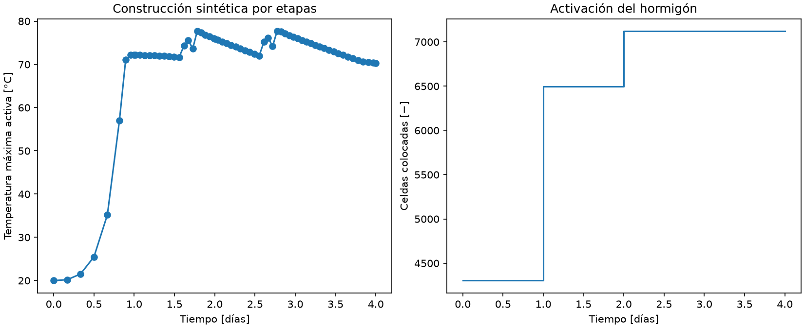

# IFC, vertidas y activación térmica

Implementación inicial basada en G04, G05 y las secciones 23–25 de la guía
de difusión. El IFC sigue siendo la fuente de geometría; las propiedades y
el cronograma del ejemplo son **supuestos sintéticos**, no datos medidos.

## Ejecutar y modificar

Desde la raíz del repositorio, en CMD:

```cmd
.venv\Scripts\python.exe -m scripts.construction_demo
.venv\Scripts\python.exe -m pytest -q tests/test_construction.py
```

La configuración está en [`config/construction_g8.json`](../config/construction_g8.json).
`case_config` resuelve el archivo del caso relativo al JSON de construcción;
de él se obtiene la ruta del IFC y sus GUID. No se reconstruyen sólidos desde
las dimensiones del JSON. El IFC de referencia es
[`models/g8_base.ifc`](../models/g8_base.ifc), reconstrucción docente de 3,30 m.

Cada entrada de `pours` contiene:

| Campo | Significado |
|---|---|
| `id` | Identificador entero positivo y único |
| `z_min_fraction`, `z_max_fraction` | Intervalo relativo a la altura total del IFC, entre 0 y 1 |
| `start_s` | Instante de colocación, en segundos desde el inicio del cálculo |
| `placement_c` | Temperatura del hormigón al colocarlo, en °C |

Las capas deben cubrir toda la altura sin huecos ni solapamientos y contener
celdas. Los centros determinan su pertenencia: refinar la malla si una capa
no se captura. El cronograma es independiente del identificador de componente
IFC. No se presupone que los tres objetos BIM sean tres vertidas.

El ejemplo utiliza tres capas de igual altura, colocadas a los 0, 1 y 2 días,
a 20 °C, y una simulación de 4 días. Estos valores son supuestos de ensayo.
Se supone colocación instantánea de cada capa completa.

## Hidratación inicial

Se conserva el pulso sintético del visor, ahora en función de la **edad local**
de cada vertida: `a = te`, edad equivalente por celda a referencia de 20 °C.

\[
\dot q_h(a)=\frac{Q_{\max}}2[1-\cos(2\pi a/\tau)],\quad 0\le a<\tau;
\qquad \dot q_h=0\text{ fuera del intervalo}.
\]

`Qmax = 1300 W/m³` y `τ = 172800 s` en el ejemplo. Su integral completa es
`Qmax·τ/2 = 112320000 J/m³`. La conexión física con una curva adiabática es
`q_h = ρ cp dθ_ad/dt`. No representa cinética calibrada, grado de hidratación
por sí sola: la dependencia térmica se incorpora mediante Arrhenius.
La fuente se evalúa en
`t_n`, al inicio de cada paso, por lo que su integral numérica es una suma
izquierda; la conservación se comprueba contra esa misma energía discreta.

### Edad equivalente y temperatura

`solve_construction(..., activation_energy_j_mol=Ea)` integra por celda:

\[
f(T_n)=\exp\left[-\frac{E_a}{R}\left(\frac1{T_n+273.15}-\frac1{293.15}\right)\right],
\quad \dot q_n=\mathrm{rate}(te_n)f(T_n),
\quad te_{n+1}=te_n+\Delta t\,f(T_n).
\]

R = 8,31446261815324 J/(mol·K); Ea se expresa en J/mol, te y dt en segundos.
Se usa la temperatura al inicio del paso para ambas operaciones; la fuente
no se evalúa adelantando primero te. La temperatura debe ser superior al cero
absoluto. A 20 °C el factor vale uno; con Ea positiva aumenta al calentar.
El factor multiplica la potencia por la regla de la cadena, porque `rate`
se define por segundo equivalente y el balance usa tiempo físico.

El campo te parte en cero y permanece en cero antes de colocar. Se guarda
en `ConstructionSolution.equivalent_age_s` y en `construction.npz` con los
mismos instantes que T. El paso limita también el incremento equivalente a
τ/100, para resolver el pulso cuando se acelera la reacción.

Editar `kinetics.activation_energy_j_mol` en el JSON de construcción. El valor
actual es **33500 J/mol**, aportado por el usuario con referencia indicada
Freiesleben Hansen–Pedersen. No es una calibración experimental de la mezcla
G8. Ea=0 conserva el reloj cronológico. El HTML permite editar Ea en el apartado
de construcción y utiliza la misma ecuación en Python y en el modo portátil.
La prueba adicional con 35000 J/mol es sintética y no calibra G8.

## Activación y balance

`vertida_id` identifica todo el hormigón futuro. `active(t)` incluye únicamente
las celdas ya colocadas. Las futuras no generan calor ni intercambian energía.
Su temperatura almacenada en cero es un marcador: **no debe graficarse como
temperatura física**, sino ocultarse usando la máscara de cada instante.

Al llegar a un inicio de vertida, se asigna `placement_c` y se reconstruyen
conductancias y superficies expuestas. Hasta la colocación de la capa vecina,
su interfaz recibe `exposed`; después es una interfaz conductiva interna.
En el ejemplo, Robin con aire a 20 °C y h=10 W/(m²·K) en superficies expuestas;
base adiabática. No hay suelo ni moldaje explícitos.

`dt_s` es un máximo solicitado: el solver limita cada paso a 0,8 del menor
límite de estabilidad general/local, a τ/100 y al siguiente evento o final.
Solo reconstruye coeficientes al activar celdas. Guarda el estado inicial,
cada `save_every` pasos, los eventos y siempre el final, posteriores a colocar.

\[
E(t)-E(0)=Q_{borde}+Q_{fuente}+E_{colocación}.
\]

`E_colocación = Σ ρ cp V T_colocación` cuenta únicamente las activaciones
posteriores a cero, con referencia térmica a 0 °C; las iniciales ya están en
`E(0)`. No es una generación de calor adicional.

## Salidas y verificación

[`results/construction/resumen.json`](../results/construction/resumen.json)
registra configuración, SHA-256 IFC, cotas, volúmenes por vertida, temperaturas,
estados activos y balance. `construction.npz` conserva componentes, grilla,
`vertida_id`, campos de inicio/colocación y estados térmicos con sus máscaras.

En la ejecución inicial: 7120 celdas geométricas, volumen IFC 487,350199 m³,
volumen voxelizado 489,500004 m³, residuo relativo máximo de energía
2,222927 × 10⁻¹⁵ tras incorporar Ea = 33500 J/mol. Son resultados calculados guardados en ese JSON, con la
resolución solicitada 0,5 × 0,5 × 0,275 m.

Las pruebas verifican cobertura y volumen, planes inválidos, eventos exactos,
ausencia de intercambio con hormigón futuro, energía de colocación, dominio
inicialmente vacío, activación final, enfriamiento de superficies temporales,
edad local y equivalencia con el solver fijo cuando todo se coloca al inicio.

Verificación del 3 de noviembre de 2026: 12 pruebas específicas aprobadas;
batería completa, 211 aprobadas en 82,52 s. Se comprobó también que el NPZ
conserva cobertura de etiquetas, suma de volúmenes y marcadores inactivos.

Ampliación del 4 de noviembre: edad equivalente isotérmica, reinicio al colocar,
regla de la cadena, evaluación en t_n y equivalencia Ea=0 verificados. La batería
completa aprobó 228 pruebas en 135,91 s; también se contrastaron Python y el
HTML con Ea=33500 J/mol, incluidos los campos te y las potencias por vertida.



Esta funcionalidad se ejecuta en Python y está conectada al HTML mediante
**Construcción → Por etapas**. El visor permite definir el inicio y la
temperatura de cada capa; con servidor utiliza el solver Python y el archivo
portátil utiliza el núcleo JavaScript contrastado con ese solver. El cronograma
del visor es propio de cada ensayo y no sobrescribe el JSON de construcción.
Quedan para etapas
posteriores la calibración experimental, clima real, cinética térmica avanzada,
duración de llenado, suelo y validación de una decisión constructiva.
