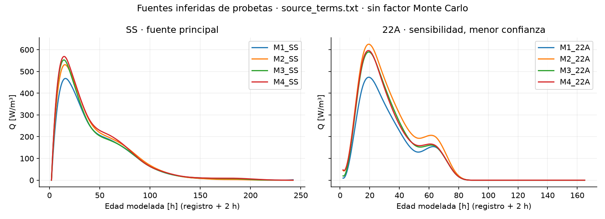
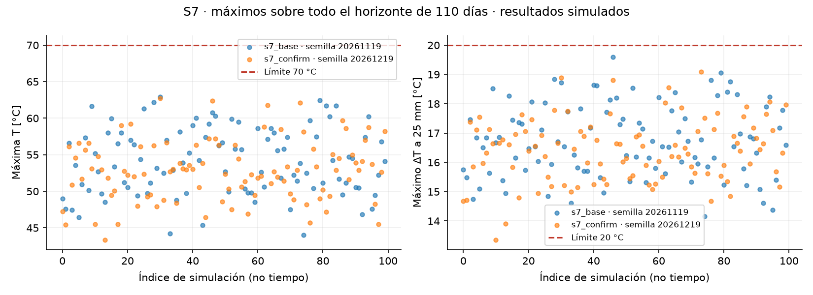
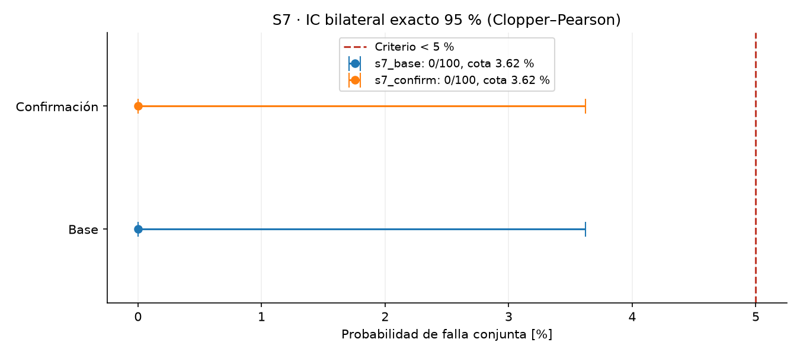

# S7: fuente de calor y resultados simulados

La copia entregada de `source_terms.txt` coincide byte a byte con
[`data/hydration/source_terms.txt`](../data/hydration/source_terms.txt).
SHA-256: `182b4a500dd02060b89dc452f007a379c7ab6cdc569e67de59a04c00d3497956`.
Este hash también coincide con los manifiestos y las comparaciones de los
lotes S7 base y confirmación. Se auditaron los 200 resultados individuales
contra sus respectivos manifiestos antes de graficar.

Las curvas son fuentes **inferidas por inversión térmica de probetas**, en
W/m³, según la cabecera del archivo. No son mediciones directas de generación
de calor ni temperaturas observadas de la fundación.

## Cómo entra al cálculo

- `scripts/final_campaign.py` carga la tabla mediante `load_curves`, selecciona
  la curva del escenario y multiplica su intensidad por `heat_factor`.
- S7 utiliza M1_SS, M2_SS, M3_SS y M4_SS. El factor uniforme entre 0,84 y 1,20
  es un supuesto de incertidumbre. Las cuatro 22A se reservan para sensibilidad
  por su menor confianza y no forman parte de estos dos lotes S7.
- Se convierten horas a segundos. El origen retenido se desplaza 2 h, con una
  rampa inicial modelada y una cola exponencial de constante 24 h al terminar
  cada registro. Los NaN finales de 22A no se interpretan como mediciones cero.
- Se usan ρ = 2476 kg/m³ y cₚ = 1023 J/(kg·K). La campaña principal S7 usa
  Ea = 0, por lo que conserva la escala temporal de las curvas. No aplica
  aceleración de Arrhenius a estos resultados.
- β = 2,5 W/(m²·K), indicado en el archivo, corresponde a la inversión de
  las probetas. Las condiciones de borde de la fundación se calculan con
  clima, moldaje, mantas y subbase definidos en la campaña.

El eje horizontal del segundo gráfico es el índice del escenario. Cada punto
es un máximo sobre el horizonte completo de 110 días, no una historia temporal.
El diferencial usa la temperatura superficial reconstruida a 25 mm.

Los dos intervalos se calculan por separado. Cero fallas observadas no significa
probabilidad real nula. La conclusión está condicionada al modelo, a los
supuestos de protección hasta el día 105 y a la extensión meteorológica por
persistencia tras las primeras 165 h disponibles.

## Reproducción

Con los resultados individuales de ambos lotes disponibles en `runs/`, ejecutar
`python -m scripts.plot_s7`. La opción `--original` permite contrastar otra copia
del TXT. Después ejecutar `python -m scripts.build_dashboard` para incorporar
las figuras al visor portátil. Los `runs/` son salidas locales y se regeneran con
la campaña descrita en [Monte Carlo](MONTE_CARLO_CLUSTER.md).

Se conservan [las muestras graficadas en CSV](../results/final/g8_20261119_mc/s7_figures/samples.csv)
y [la auditoría de la fuente](../results/final/g8_20261119_mc/s7_figures/source_audit.json).
Las figuras aparecen en **Decisión G8** tanto en el visor conectado como en el
HTML portátil.
