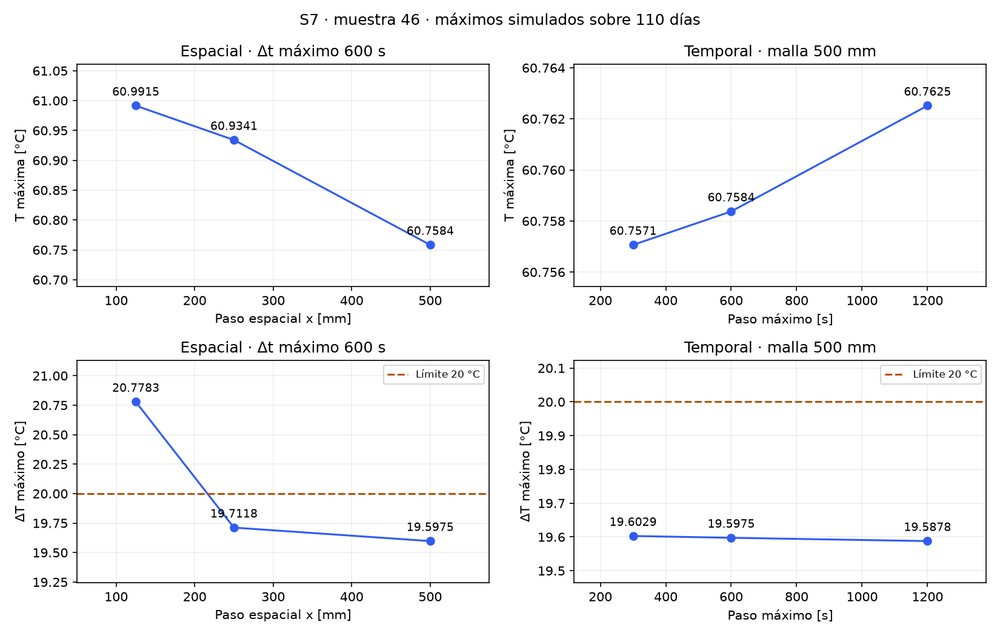

# Revisión de propiedades y factibilidad de S7

Revisión del 17 de noviembre de 2026. Se consultaron los documentos Markdown,
guías y figuras de `docs`, las configuraciones efectivas del lote S7 y la
cabecera de `data/hydration/source_terms.txt`.

**Estado de S7 en obra: pendiente de validación de materiales y factibilidad
constructiva.** La documentación disponible permite comprobar procedencia y
consistencia de parámetros. Las guías contienen valores de referencia y
supuestos docentes. Faltan fichas de materiales seleccionados, certificados
de la mezcla de obra y confirmación del suministro y equipos.

## Propiedades efectivamente empleadas

| Parámetro | Valor de S7 | Respaldo disponible | Validación pendiente |
|---|---|---|---|
| Conductividad del hormigón | 2,2 W/(m·K) | Caso docente, próximo a 2,22 de Ju y Lei en difusión §31 | Medición o ficha de la mezcla, con humedad y temperatura de ensayo |
| Densidad y calor específico | 2476 kg/m³ y 1023 J/(kg·K) | Cabecera de `source_terms.txt`, propiedades usadas en la inversión | Confirmar método de determinación y correspondencia con la mezcla de obra |
| Fuente de hidratación | M1–M4 SS, W/m³ | Inversión de probetas entregada, integral comprobada | Receta de cada probeta, registros originales, calibración y validación independiente |
| Factor de calor | Uniforme 0,84–1,20 | Supuesto del Monte Carlo | Distribución sustentada en datos y dependencia con otras variables |
| Edad de hidratación | Cronológica, Ea = 0 | Convención principal para las curvas entregadas | Calibrar dependencia térmica antes de atribuir validez física a Arrhenius |
| Mantas | k = 0,04 W/(m·K) | `environment_g8.json`, supuesto explícito E10 | Producto, k en servicio, humedad, compresión, juntas y fijación |
| Subbase | R'' = 2,50 m²·K/W | Resistencia térmica de diseño de S7 | Material, espesor, rigidez, fluencia, contacto y aprobación estructural/geotécnica |
| Moldaje | 18 mm, k = 0,13 W/(m·K) | Terciado típico, supuesto E10 | Producto, humedad, contacto y resistencia para desmolde |
| Suelo | k = 1,39, ρ = 1800, cp = 1273 en SI | Valores del caso Ju y Lei, difusión §31 | Caracterización del emplazamiento y humedad |
| Temperatura profunda | Uniforme 8–12 °C en Monte Carlo | Supuesto | Registro térmico local y variación estacional |
| Colocación | Nominal 16 °C, variación ±2 °C | Hipótesis de operación | Control de planta, transporte y medición a descarga |
| Intercambio exterior | h = 5,7 + 3,8 v₂ | Correlación de literatura E10 | Representatividad en la geometría, viento local y protecciones |
| Clima | 165 h de ensamble y 2475 h de persistencia | Snapshot trazable y extensión modelada | Evidencia representativa del horizonte de 110 días |

La guía de difusión §31 advierte expresamente que sus propiedades sirven para
comprobaciones de orden de magnitud. El documento E10 clasifica la manta y la
temperatura profunda como supuestos. La cabecera de las fuentes identifica
el método de inversión, pero carece de certificados de ensayo adjuntos.
[Guía de difusión](guias/DIFUSION_DE_CALOR_1D_2D_3D.md),
[supuestos E10](E10_entorno_moldaje_clima.md),
[fuente entregada](../data/hydration/source_terms.txt).

## Comprobación constructiva

El cronograma mantiene una bomba, 40 m³/h y aproximadamente 484,41 m³. Su
duración calculada es 12,11 h desde el 19 de noviembre de 2026 a las 08:00
de Santiago. Exige suministro y colocación continuos durante ese período.
El caudal debe sostenerse después de considerar transporte, descarga,
vibrado y contingencias. Si la capacidad útil de un camión es C m³ y el ciclo
completo dura τ horas, el mínimo teórico de vehículos es ceil(40 τ / C),
antes de incorporar reserva. C y τ requieren datos de la planta.

| Elemento | Condición modelada | Evidencia necesaria para ejecutarlo |
|---|---|---|
| Vertida única | Activación progresiva de niveles horizontales | Procedimiento de colocación, vibrado, continuidad y juntas imprevistas |
| Protección periférica y lateral | Espesor equivalente inicial 175 mm | Capas comerciales disponibles, montaje, continuidad y retención frente a viento/lluvia |
| Protección central | Espesor equivalente inicial 45 mm | Plano de sectores y continuidad de cobertura |
| Retiros | Días 35, 60, 80, 95 y 105 | Inspección térmica, protocolo de retiro y capacidad de reinstalar protección |
| Desmolde | 72 h | Resistencia suficiente y cambio de protección sin discontinuidades |
| Subbase aislante | Resistencia de contacto entre suelo y hormigón | Compatibilidad con cargas de torre, momentos, ciclos, asentamientos y anclajes |

Los 175 mm con k = 0,04 representan R'' = 4,375 m²·K/W. Los 45 mm
representan 1,125 m²·K/W. Son resistencias equivalentes de diseño, sujetas a
las condiciones reales de las capas. El modelo aproxima la subbase como una
resistencia sin capacidad térmica y mantiene la geometría del hormigón.
Una subbase material tiene espesor, capacidad y deformaciones que requieren
revisión específica.

Como contraste de disponibilidad técnica, FOAMGLAS S3 publica λ ≤ 0,045
W/(m·K), espesores de 40–200 mm y CS ≥ 900 kPa, e incluye losas de fundación
entre sus aplicaciones. Con λ = 0,045, la resistencia objetivo exigiría
112,5 mm por e = R'' λ. Este cálculo identifica una escala de espesor.
La elección del producto y la carga admisible de la fundación siguen
pendientes de diseño estructural, condiciones de servicio y disponibilidad
local. El fabricante exige confirmar la especificación con un ingeniero
estructural. Consulta del 17 de noviembre de 2026.
[Ficha oficial de FOAMGLAS S3](https://www.foamglas.com/en/products/fgbs3slabs).

## Cierre de la validación

Para cerrar la validación física se deben vincular los certificados y fichas
a los parámetros, incorporar su incertidumbre y contrastar la predicción
con una historia térmica independiente. Para cerrar la factibilidad se
necesitan el procedimiento de obra, disponibilidad de equipos/materiales y
la revisión de la subbase. El ensayo de refinamiento evalúa la solución
numérica de las hipótesis actuales. El resultado del riesgo queda
condicionado a esas hipótesis.

La especificación ICH se conserva como referencia del Plan de Control de
Temperatura del curso.
[Publicación oficial ICH](https://ich.cl/documentos-ich/especificacion-para-hormigon-masivo-estructural/).

## Verificación numérica del escenario crítico

Se conserva la muestra 46, con mayor diferencial del lote base, y el horizonte
de 110 días. El estudio espacial fija Δt máximo en 600 s. El temporal fija la
malla de 500 × 500 × 550 mm y compara 1200, 600 y 300 s. En este último, el
ΔT pasa de 19,5878 a 19,5975 y a 19,6029 °C. El orden aparente en ΔT es 0,86 y
el último cambio es 0,00537 °C. Al ser máximos globales, estos órdenes pueden
verse afectados por cambios de posición e instante del máximo. La temperatura
a 25 mm se reconstruye desde la cara voxelizada. Refinar reduce la distancia
entre la cara y el centro, y también cambia la aproximación geométrica.
[Resultados por malla y paso](../results/final/s7_convergence/summary.json).

| Malla efectiva [mm] | T máxima [°C] | ΔT máximo [°C] | Hora del ΔT desde t₀ |
|---|---:|---:|---:|
| 500 × 500 × 550 | 60,7584 | 19,5975 | 2540,00 |
| 250 × 250 × 275 | 60,9341 | 19,7118 | 2541,50 |
| 125 × 125 × 132 | 60,9915 | **20,7783** | 2542,17 |

El voxelizador ajustó la altura a 25 celdas. El último cambio de ΔT
es +1,0666 °C, mayor que el anterior de +0,1143 °C. Cambia también la
cara crítica, de x+ a z+ y de vuelta a x+. El máximo fino se ubica en un
escalón voxelizado junto a una cara oblicua del zócalo. La secuencia del
diferencial no demuestra convergencia espacial. La temperatura máxima muestra
cambios decrecientes, pero no se extrapola con un cociente uniforme porque
el paso vertical no se redujo exactamente a la mitad. Los tres horizontes
cerraron. La muestra fina excede el límite de 20 °C en 0,7783 °C. El riesgo
con malla fina sigue sin calcularse y corresponde revisar S7 antes de
defender su cumplimiento. [Resultado fino](../results/final/s7_convergence/mesh_0.5_dt_600.json).



Para repetir las corridas en una carpeta nueva desde la raíz del proyecto:

```powershell
$salida = 'results/final/s7_repro'
python -m scripts.verify_s7 --mesh 2 --dt 600 --output $salida
python -m scripts.verify_s7 --mesh 2 --dt 300 --output $salida
python -m scripts.verify_s7 --mesh 0.5 --dt 600 --output $salida
python -m scripts.verify_s7 --aggregate --output $salida
```

El agregador recupera la malla intermedia y el caso de 1200 s de la
[referencia archivada](../results/final/s7_convergence/reference.json).

## Actualización de Open-Meteo del 17 de noviembre

Se descargó un ensamble GFS Seamless para el punto oficial **−41,222539,
−73,295603**. Los 31 miembros tienen 373 marcas horarias válidas consecutivas
desde el inicio para temperatura a 2 m, viento a 10 m y radiación de onda corta.
Esto cubre la colocación y las 336 horas de la ventana docente, desde el
19 de noviembre a las 08:00 hasta el 3 de diciembre a las 08:00 de Santiago.
El CSV presenta los percentiles horarios entre miembros. Son pronósticos.
[Metadata y consulta](../data/weather/2026-11-17T1622Z_ensemble/metadata.json) ·
[CSV de los primeros 14 días](../results/final/s7_convergence/open_meteo_14d.csv) ·
[API de ensambles de Open-Meteo](https://open-meteo.com/en/docs/ensemble-api).

Al sustituir solo el clima en la muestra 46, con malla de 500 × 500 × 550 mm
y paso máximo de 600 s, T máxima cambió de 60,7584 a 60,8389 °C y ΔT máximo
de 19,5975 a 18,4208 °C. Este ensayo individual usa 373 h de ensamble y 2267 h
modeladas por persistencia. La probabilidad de los dos lotes S7 procede del
ensamble anterior y no se recalculó con el nuevo. El nuevo pronóstico no
cubre el retiro final del día 105.
[Corrida con el ensamble actualizado](../results/final/s7_convergence/mesh_2_dt_600_2026-11-17T1622Z_ensemble.json).

```powershell
python -m scripts.fetch_weather --kind ensemble --model gfs_seamless --days 18
python -m scripts.verify_s7 --mesh 2 --dt 600 --weather-snapshot data/weather/2026-11-17T1622Z_ensemble --output results/final/s7_repro
```
