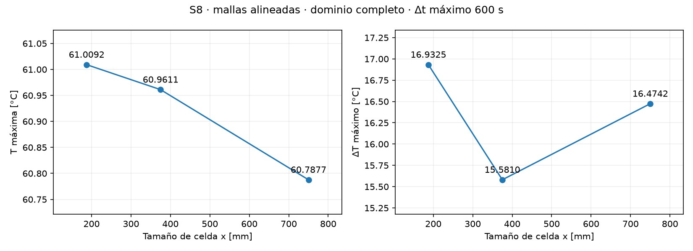

# Estudio de mallas alineadas de S8

Se mantiene la candidata S8, el escenario 46 de la referencia S7, el
pronóstico original y el horizonte de 157 días. El estudio busca estabilizar
el máximo global de temperatura y el diferencial a 25 mm. El escenario
crítico del Monte Carlo actualizado debe evaluarse por separado.

## Secuencia definida

| Celdas del hormigón en la caja IFC | Δx y Δy [mm] | Δz aproximado [mm] |
|---|---:|---:|
| 24 × 24 × 6 | 750 | 550 |
| 48 × 48 × 12 | 375 | 275 |
| 96 × 96 × 24 | 187,5 | 137,5 |

Cada paso se reduce a la mitad en las tres direcciones. Los niveles de
1,10 m del BIM quedan sobre planos de celda y el suelo conserva su extensión.
La solicitud al voxelizador incluye una holgura relativa de 10⁻¹² para impedir
que el ruido del IFC añada una celda por redondeo. Se conserva la máscara
calculada por clasificación de centros a partir de los triángulos IFC.

Se usa Δt máximo de 600 s en las tres mallas y se repite la intermedia con
300 s para comprobar la contribución temporal. El solver también acorta
pasos para estabilidad y eventos de construcción y protección.

## Simetría y límites geométricos

Se ensayó un cuarto del dominio durante 24 h en la malla inicial. Los
máximos coincidieron con el dominio completo. En las mallas siguientes se
detectaron diferencias entre máscaras reflejadas. La perturbación de rayos
y los centros sobre las caras trianguladas influyen en esa clasificación.
La prueba de simetría rechazó esas mallas, por lo que el estudio definitivo
emplea el dominio completo. Los resultados preliminares de 24 h se conservan
separados y no se usan para establecer convergencia del horizonte completo.

## Objetivo exploratorio de precisión

Se eligieron para este estudio 0,20 °C de cambio espacial final y 0,02 °C de
cambio temporal. Son objetivos numéricos propuestos, equivalentes al 1 % y
0,1 % del límite docente de 20 °C, sujetos a aceptación del curso.

Para considerar estabilizada una secuencia se exige que las diferencias
entre niveles disminuyan monótonamente, que el último cambio sea como máximo
0,20 °C y que la distancia de la malla fina a la extrapolación de Richardson
también sea como máximo 0,20 °C. Si las diferencias cambian de signo o crecen,
el orden y la extrapolación se declaran indeterminados. La comprobación
temporal debe quedar dentro de 0,02 °C para ambos indicadores.

Richardson aplicado a máximos globales proporciona un orden aparente. La
posición del máximo y la geometría voxelizada pueden cambiar entre niveles.
La reconstrucción a 25 mm continúa referida a las caras voxelizadas.
El cumplimiento del umbral térmico y la estabilización numérica se evalúan
con sus métricas respectivas.

## Separación física de las protecciones

En el procedimiento anterior la cubierta central se aplicaba a columnas cuyo
espesor sumado de celdas activas alcanzaba 2 m. Esto hace depender el área
protegida de Δz. La nueva variante toma la sección horizontal del IFC a 2 m
sobre su base y proyecta esa máscara para asignar la cubierta central.
Las columnas restantes reciben la protección periférica. Se conservan los
espesores, materiales y retiros de S8.

Las dos definiciones se archivan por separado como `full` y `fixed`. El estudio
con definición física emplea `fixed` en las cuatro corridas. Esta corrección
de la asignación de protección debe incorporarse explícitamente al modelo
antes de utilizar su malla en nuevos lotes Monte Carlo. Los intervalos de los
lotes existentes conservan la definición por conteo de celdas.

## Ejecución reproducible

```powershell
python -m scripts.converge_s8 --n 24 --dt 600 --fixed-protection
python -m scripts.converge_s8 --n 48 --dt 600 --fixed-protection
python -m scripts.converge_s8 --n 96 --dt 600 --fixed-protection
python -m scripts.converge_s8 --n 48 --dt 300 --fixed-protection
python -m scripts.converge_s8 --aggregate --fixed-protection
```

Cada corrida conserva configuración, materiales, escenario, hash del IFC,
fuente y pronóstico, espaciamientos efectivos, máximos, coordenadas e
instantes. El agregado presenta las diferencias y el resultado del objetivo
exploratorio. Un resultado existente se protege frente a sobreescritura.
[Directorio de resultados](../results/final/s8_aligned/).

## Resultados calculados

Con la separación de protección definida por la sección IFC a 2 m:

| Celda x × y × z [mm] | T máxima [°C] | ΔT máximo [°C] | t del ΔT [h] |
|---|---:|---:|---:|
| 750 × 750 × 550 | 60,7877 | 16,4742 | 3668 |
| 375 × 375 × 275 | 60,9611 | 15,5810 | 3644 |
| 187,5 × 187,5 × 137,5 | 61,0092 | 16,9325 | 3646 |

Los tres horizontes cerraron. T máxima tiene orden aparente 1,8513 y
extrapolación 61,0276 °C. La diferencia final es 0,0480 °C y la distancia de
la solución fina a la extrapolación es 0,0184 °C, dentro del objetivo
exploratorio. El cambio temporal de T máxima es 0,00158 °C.

El diferencial primero baja 0,8932 °C y luego sube 1,3515 °C. Su orden de
Richardson queda indeterminado. La reducción del paso temporal cambia ΔT
0,00234 °C en la malla intermedia, mucho menos que el último salto espacial.
La corrección del mapa de protecciones por sí sola no estabiliza ΔT.

Las coordenadas del punto frío cambian. Su altura es aproximadamente 0,275,
0,1375 y 1,03125 m, respectivamente, con cara crítica x+ en los tres casos.
Por tanto, el máximo global no está siguiendo el mismo punto físico. La
comparación con los triángulos IFC se conserva como diagnóstico geométrico.
[Diagnóstico](../results/final/s8_aligned/geometry_checks.json).

**No se selecciona una malla convergida para el diferencial.** La malla de
187,5 × 187,5 × 137,5 mm satisface el objetivo exploratorio de T máxima para
este escenario, pero deja pendiente el indicador de falla por ΔT. La
secuencia anterior por conteo de columnas también resultó no monótona.
Una selección final para el riesgo del caso requiere estabilizar ese
indicador y contrastar la reconstrucción a 25 mm con las superficies físicas
del IFC, además de evaluar el escenario crítico del propio Monte Carlo S8.



[Resumen con todos los valores](../results/final/s8_aligned/summary.json),
[comparación con la definición anterior](../results/final/s8_aligned/summary_legacy.json).
