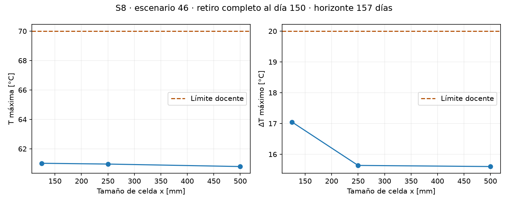
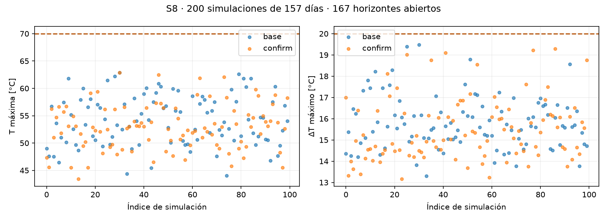

# Candidata S8 con capas comerciales

Se ensayan alternativas al plan S7 después de que su malla fina alcanzara
20,7783 °C de diferencial. La muestra 46 del lote base aporta la curva M3_SS,
su factor de calor y las condiciones de colocación, suelo y clima.
El escenario conserva el IFC, la vertida única y la bomba de 40 m³/h.

## Materiales propuestos e hipótesis

- Mantas en capas de 50 y 100 mm, compatibles dimensionalmente con los
  espesores publicados por Safe Energy. Se adopta k = 0,042 W/(m·K)
  constante como hipótesis de servicio. La ficha publica ese valor de prueba
  a 93 °C y 0,034 a 24 °C. Humedad, contacto, envolvente, fijaciones y
  aptitud para curado requieren evaluación específica.
- Subbase de 120 mm con λ = 0,045 W/(m·K), como propuesta basada en
  FOAMGLAS S3. Su resistencia calculada es 2,667 m²·K/W. El modelo la
  representa mediante resistencia de contacto sin capacidad térmica.
  Las cargas cíclicas y la rigidez de la fundación necesitan aprobación
  estructural y geotécnica, y el suministro local queda pendiente.

[Ficha de manta](https://safe-energy.cl/pdf/safe/Manta_con_malla_Safe_Energy.pdf),
[guía de aislación enterrada](https://www.foamglas.com/-/media/project/foamglas/public/shared/files/tds/tg-03---below-ground-insulation.pdf),
[investigación de materiales](S7_INVESTIGACION_MATERIALES.md).

## Programa de la candidata

| Día desde t₀ | Mantas periféricas y laterales [mm] | Cubierta central [mm] |
|---|---:|---:|
| 0 | 200 | 50 |
| 35 | 150 | 50 |
| 60 | 100 | 50 |
| 80 | 50 | 50 |
| 150 | 0 | 0 |

La duración de colocación continúa siendo aproximadamente 12,11 h.
El horizonte térmico llega al día 157, siete días después del retiro.
El mantenimiento de mantas durante 150 días constituye un requisito
operativo de la candidata y debe presupuestarse y aprobarse.

## Exploración y verificación

Se exploraron diez alternativas en malla de 500 × 500 × 550 mm.
Las variantes que retiran protección hasta 50 mm el día 35 superaron
20 °C. El programa escalonado con retiro al día 105 también superó el límite.
El mismo programa con retiro al día 150 obtuvo 15,6020 °C de diferencial
y 60,7930 °C de temperatura máxima en esa malla, con horizonte cerrado.
La comparación completa, incluidas las alternativas fallidas, se conserva
en los resultados.
[Resumen y métricas](../results/final/s8_candidates/summary.json).

| Tamaño efectivo de celda [mm] | T máxima [°C] | ΔT máximo [°C] | Hora del ΔT desde t₀ |
|---|---:|---:|---:|
| 500 × 500 × 550 | 60,7930 | 15,6020 | 3668,0 |
| 250 × 250 × 275 | 60,9617 | 15,6383 | 3645,5 |
| 125 × 125 × 132 | 61,0152 | 17,0489 | 3621,5 |

El margen del escenario fino hasta 20 °C es 2,9511 °C. Los tres horizontes
cerraron. El máximo ocurre después del retiro total, dentro del horizonte.
El residuo energético relativo fino fue 2,3225 × 10⁻¹⁵. El último salto de
ΔT, 1,4106 °C, supera el previo de 0,0363 °C. La secuencia mantiene margen
pero deja pendiente la convergencia espacial de ese indicador. El cambio de
geometría voxelizada y de posición del máximo limita la extrapolación.



Los resultados corresponden al escenario crítico de S7 con su pronóstico
original y extensión por persistencia. El Monte Carlo propio de S8 se
documenta más abajo. La validación de los materiales en obra sigue pendiente. Los datos
de propiedades del hormigón conservan sus hipótesis anteriores.

## Reproducción

```powershell
python -m scripts.search_s8
python -m scripts.search_s8 --plan S8-staged-3600h --mesh 1
python -m scripts.search_s8 --plan S8-staged-3600h --mesh 0.5
python -m scripts.search_s8 --aggregate
python -m scripts.build_dashboard
```

Cada corrida falla si su archivo de salida ya existe para proteger el
resultado previo. El agregador registra todas las métricas y exporta la
configuración de la candidata y su entorno. Ambos archivos deben utilizarse
juntos porque la conductividad de las mantas difiere de la de S7.

## Monte Carlo propio y confirmación independiente

Se ejecutaron 100 realizaciones por lote, con semillas 20261119 y 20261219,
en malla de 500 × 500 × 550 mm y paso máximo 600 s. Se cargó el entorno
de S8 con k de mantas 0,042 W/(m·K). Se mantuvieron las distribuciones
documentadas de calor, colocación y suelo y las curvas SS. El ensamble del
17 de noviembre cubre 373 h completas desde t₀. Las restantes 3395 h de
los 157 días proceden de persistencia modelada.

| Lote | Fallas en 157 días | IC bilateral 95 % de la unión | T máxima absoluta [°C] | ΔT máximo [°C] | Horizontes abiertos |
|---|---:|---:|---:|---:|---:|
| Base | 0/100 | 0–3,6217 % | 62,8482 | 19,4819 | 81 |
| Confirmación | 0/100 | 0–3,6217 % | 62,8922 | 19,2932 | 86 |

El cumplimiento integral de S8 queda pendiente porque hay máximos cerca del
final del horizonte. La muestra 4 del lote base se extendió a 240 días en
malla base y obtuvo 16,3353 °C a las 3954 h, con horizonte cerrado. La muestra
3 llegó a 16,6977 °C a las 5755 h y conservó horizonte abierto, mostrando el
efecto del ciclo diario de persistencia en máximos tardíos.

La muestra 30, peor ΔT del lote base a 157 días, se repitió en malla de
250 × 250 × 275 mm hasta 240 días. Obtuvo T máxima 63,0266 °C y ΔT máximo
19,2241 °C a las 3909,5 h, con horizonte cerrado. Al cambiar simultáneamente
malla y horizonte, esa corrida aporta una comprobación adicional y deja
pendiente el orden de convergencia del escenario.
[Resumen reproducible](../results/final/s8_mc/summary.json),
[métricas de las 200 realizaciones](../results/final/s8_mc/samples.csv).



```powershell
python -m scripts.final_mc sample results/final/s8_repro/base --config config/monte_carlo_s8.json
python -m scripts.final_campaign local results/final/s8_repro/base --workers 6
python -m scripts.final_mc aggregate results/final/s8_repro/base
python -m scripts.final_mc confirm results/final/s8_repro/confirm --config config/monte_carlo_s8.json --plan S8-staged-3600h
python -m scripts.final_campaign local results/final/s8_repro/confirm --workers 6
python -m scripts.final_mc aggregate results/final/s8_repro/confirm
```

La confirmación verifica repetibilidad con otra semilla. Conservar ambos lotes
permite revisar la limitación del horizonte incluso cuando no hay fallas
observadas. Las evidencias de validación y las solicitudes a los responsables
se detallan en [validación y aceptación](S8_VALIDACION_Y_ACEPTACION.md).
