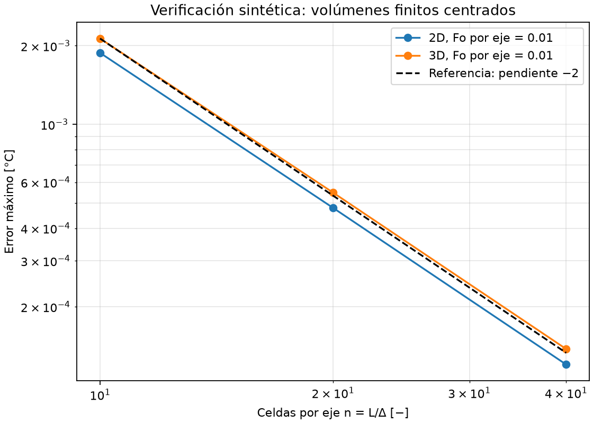
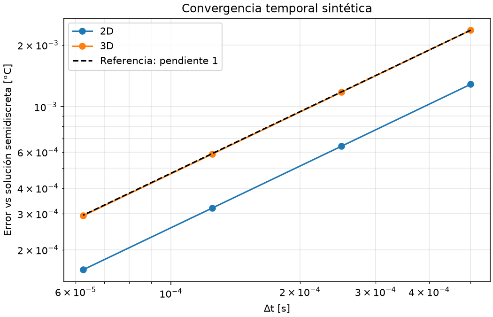
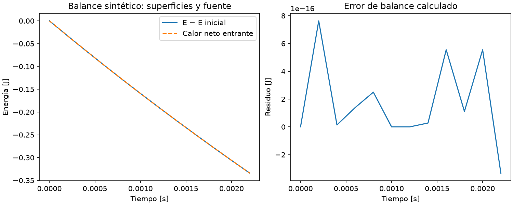
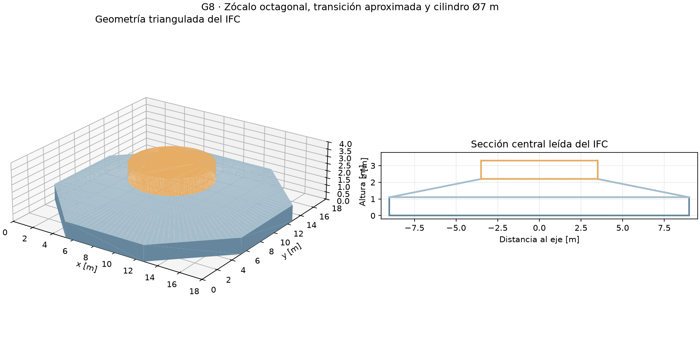

# Reporte 01 — Verificación térmica y BIM base

**G8 · Cuatro Vientos, Llanquihue · 30 de octubre de 2026.**

El propósito es verificar el solver propio antes de utilizarlo para justificar
vertidas. **Todos los parámetros y resultados térmicos son sintéticos; no son
mediciones ni validación experimental del hormigón G8.** La geometría es una
reconstrucción docente del [dibujo acotado](../docs/foundation_dimensions.png).

Las cifras proceden de los JSON versionados de [verificación base](../results/verification_3d/resumen.json),
[convergencia temporal](../results/convergence_nd/resumen.json) y
[verificación adicional](../results/verification/resultados.json). Se recalcularon
y contrastaron con esos archivos el 30 de octubre: coincidencia numérica y
**16/16 criterios de la batería base aprobados**.

## 1. Matriz de verificación

Los errores de temperatura son máximos absolutos, salvo indicación. Los
criterios están implementados en `thermal3d.verification.acceptance` y en
los scripts correspondientes; «OK» identifica comprobaciones satisfechas.

| Test | Qué verifica | Error/métrica | Resultado |
| ---- | ------------ | ------------- | --------- |
| Seno 2D | Difusión y Dirichlet en cuatro caras | Error fino 1.201467e−4 °C; órdenes 1.972885 / 1.993250 | OK, segundo orden |
| Seno 3D | Stencil y Dirichlet en seis caras | Error fino 1.377562e−4 °C; órdenes 1.960988 / 1.990289 | OK, segundo orden |
| Temporal 2D | Euler explícito | Órdenes 1.004047 / 1.002018 / 1.001008 | OK, primer orden |
| Temporal 3D | Euler explícito | Órdenes 1.005559 / 1.002769 / 1.001382 | OK, primer orden |
| Energía adiabática | Cancelación de flujos internos | Error relativo 1.774818e−16 | OK |
| Fuente constante | Aumento en todas las celdas | Error relativo del incremento 5.350252e−14 | OK |
| Fuente variable | Evaluación en inicio del paso | Error relativo del incremento 3.036981e−16 | OK |
| Neumann | Signo y áreas de las caras | Error energético relativo máximo 8.064942e−15 | OK |
| Robin 3D frente a 1D fino | Resistencias y transitorio | Error fino 4.470141e−5 °C; órdenes 1.875635 / 1.951416 | OK |
| Máscara con hueco y recorte | Conservación y celdas inactivas | Energía: 2.190793e−16 relativo; inactivas: 0 °C | OK |
| Anisotropía | Ejes y separaciones distintos | Error frente a modo discreto 1D: 6.661338e−16 °C | OK |
| Estabilidad | Rechazo sobre ambos límites | General: 0.010416667 s; local: 0.006944481 s | OK: acepta debajo y rechaza encima |
| Robin, fuente y superficie expuesta | Balance energético completo | Residuo relativo 2.934969e−16 | OK |

## 2. Convergencia espacial

Se resuelve el seno exacto `T = ∏sin(πx_a) exp(−dπ²αt)` en cajas unitarias,
con Dirichlet cero, centros `x_i = (i+½)Δx` y `Δx = L/n`. El material de
ensayo usa k = 1 W/(m·K), ρ = 1 kg/m³ y cp = 1 J/(kg·K).
Se fija `Fo = αΔt/Δx² = 0.01`, con `Δt ∝ Δx²`, hasta 0.02 s.

| Celdas por eje n | Error 2D [°C] | Error 3D [°C] |
| --- | ---: | ---: |
| 10 | 1.877748e−3 | 2.130905e−3 |
| 20 | 4.783432e−4 | 5.473282e−4 |
| 40 | 1.201467e−4 | 1.377562e−4 |

El orden `p = log₂(E_n/E_2n)` se aproxima a 2. El chequeo independiente
con Fo = 0.05 reproduce 8.599209e−4, 2.178354e−4 y 5.463764e−5 °C en 2D.



## 3. Convergencia temporal

Con grilla fija de 12 celdas por eje, se compara contra la solución
**semidiscreta**, que conserva el operador espacial y elimina su error de la
comparación temporal. Se mantiene el dominio y tiempo final anteriores.

| Δt [s] | Error temporal 2D [°C] | Error temporal 3D [°C] |
| --- | ---: | ---: |
| 0.0005 | 1.285758e−3 | 2.361994e−3 |
| 0.00025 | 6.410781e−4 | 1.176455e−3 |
| 0.000125 | 3.200911e−4 | 5.870996e−4 |
| 0.0000625 | 1.599338e−4 | 2.932688e−4 |

Los errores aproximadamente se dividen por dos: orden temporal 1. La comparación
contra el continuo puede mezclar y compensar errores espaciales y temporales.



## 4. Test de energía

En aislamiento y sin fuente, `E = ΣρcpVT` debe conservarse. El error se mide
como `max|E(t)−E(0)|/|E(0)|`. Con intercambios se verifica
`E−E(0)−Q_borde−Q_fuente`. Los flujos internos se cancelan por pares;
la energía usa el cero Celsius como referencia, no una entalpía absoluta.
Ambos ensayos cumplen errores relativos inferiores a 1e−12.



## 5. Test de fuente

Con bordes adiabáticos y fuente uniforme de 3 W/m³, ρ = 2 kg/m³,
cp = 3 J/(kg·K), el incremento exacto a 0.019 s es **0.0095 °C**.
Se comprueban todas las celdas, no únicamente el promedio.
Para `q̇(t) = 7t` en SI, la referencia es la suma izquierda
`Σq̇(t_n)Δt_n/(ρcp) = 0.0001785 °C`. Se incluyen siete pasos y un último
paso acortado de 0.001 s; así se distingue evaluar en `t_n` de evaluar al final.

## 6. Test de condición Robin

Se utiliza `G_b = [1/(hA) + (Δz/2)/(kA)]⁻¹`. El ensayo tiene h inferior
de 1 y superior de 2 W/(m²·K), ambiente a 0 °C y temperatura inicial de 1 °C.
Se refinan 16, 32 y 64 celdas verticales sobre 1 m, sin variación lateral.
La referencia nodal utiliza 2049 nodos, interpolados en los centros 3D.
Su contraste con 1025 nodos difiere como máximo **2.600652e−7 °C**,
menos del 1 % del error fino 3D. Cada referencia conserva solamente dos estados.

## 7. Imagen y dimensiones del BIM base

El [IFC4 base versionado](../models/g8_base.ifc) contiene tres `IfcFooting`;
la inspección actual encuentra **cero errores de validación**. Su envolvente
nominal es **18 × 18 × 3.30 m** y su volumen triangulado, **487.350199 m³**.
La procedencia está registrada en [el resumen geométrico](../results/voxel/resumen.json).

| Objeto | Componente | Cotas nominales |
| --- | --- | --- |
| G8-BASE-01 | Zócalo octagonal | Envolvente 18 × 18 m; z = 0–1.10 m |
| G8-BASE-02 | Transición inclinada | z = 1.10–2.20 m |
| G8-BASE-03 | Cilindro superior centrado | Diámetro 7 m; z = 2.20–3.30 m |



## 8. Simplificaciones geométricas explícitas

- Reconstrucción docente del dibujo, no levantamiento de una fundación real.
- Planta octagonal simétrica definida por semieje 9 m y coordenada de esquina
  3.728 m; no se sustituye por una losa cuadrada maciza.
- Transición supuesta por interpolación radial entre octágono y círculo:
  16 subdivisiones por arista, 128 puntos por contorno y caras laterales trianguladas.
- Cilindro coaxial ideal y tramos de 1.10 m; se omiten armaduras, anclajes,
  conductos, huecos, equipos y geometría del suelo circundante.
- Voxelización por centro dentro/fuera, con celdas completas y superficies
  escalonadas; no hay celdas cortadas ni detalle subvoxel.
- Los tres sólidos BIM no representan automáticamente vertidas ni juntas reales.
  Las capas del visor son una partición geométrica, sin activación temporal.

El estudio volumétrico no demuestra convergencia térmica sobre esta geometría.
Quedan fuera la hidratación calibrada, clima real, suelo y secuencia constructiva.

## Disponibilidad y reproducción

Base reproducible: commit `a793f39e20097a074b84578f6d754102b84b3d90`.
Desde una carpeta nueva, en CMD:

```cmd
git clone https://github.com/chuntley-tech/Proyecto-2-MCOC.git
cd Proyecto-2-MCOC
git switch --detach a793f39e20097a074b84578f6d754102b84b3d90
python -m venv .venv
.venv\Scripts\python.exe -m pip install -r requirements.txt
.venv\Scripts\python.exe -m scripts.verify_3d
.venv\Scripts\python.exe -m scripts.convergence_nd
.venv\Scripts\python.exe -m scripts.verify
.venv\Scripts\python.exe -m scripts.inspect_ifc models/g8_base.ifc
```

El clon incluye IFC y figuras; no requiere una descarga privada. SHA-256 del IFC:
`a5b877686490b2ff5db6a55cfb4b0c25262fbd7b400c3fd66118b373245f2e44`.
