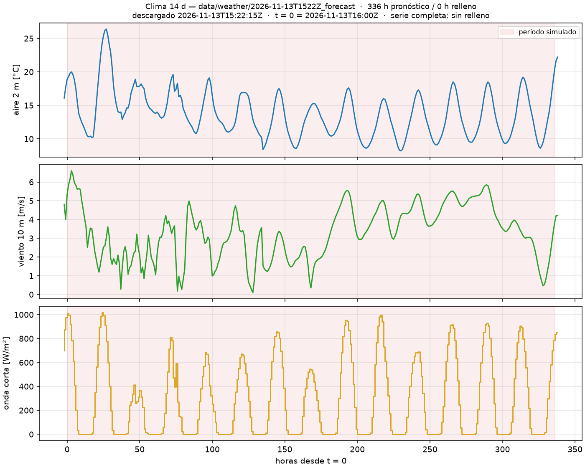
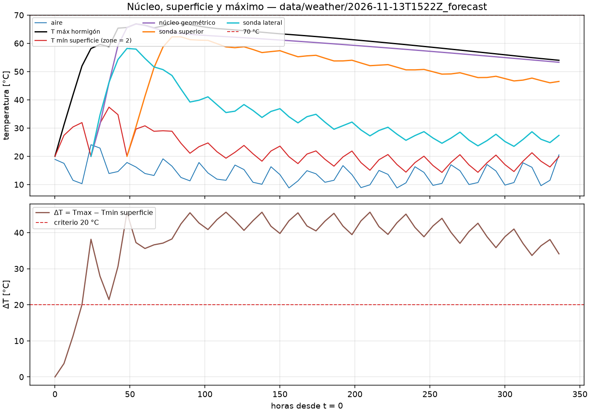
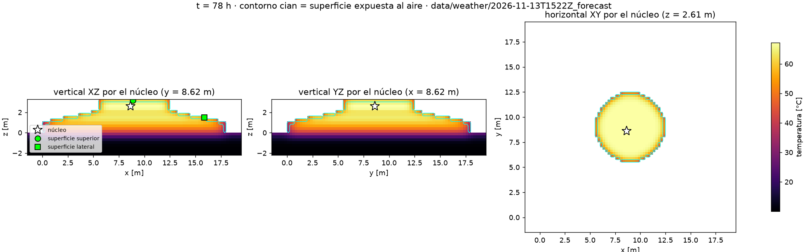

# E12 — Simulación determinista de 14 días (Grupo 8)

Este informe presenta la simulación térmica determinista de 14 días de la fundación del Grupo 8. Se evalúan la temperatura máxima del hormigón y la diferencia entre el interior y la superficie para el plan de tres vertidas, considerando la hidratación, el suelo y el pronóstico meteorológico de Llanquihue.

## 1. Integración física

`scripts/e12_case.py` une en una sola corrida:

- **Geometría:** el IFC G8 voxelizado a 0,25 × 0,25 × 0,275 m, con una grilla de 84 × 84 × 20. El volumen voxelizado es 484,4 m³, contra 487,4 m³ del IFC (error de 0,6 %).
- **Vertidas:** el plan de `config/construction_g8.json` (sección 4).
- **Hidratación:** la curva del curso (sección 3), con edad equivalente de Arrhenius por celda.
- **Suelo:** 2,2 m bajo la fundación y 1,5 m de margen lateral. Está activo desde t = 0 a 10 °C y no genera calor (`source_mask`).
- **Clima:** aire, viento y radiación horarios de un pronóstico real (sección 2).
- **Solver:** Euler explícito, dt = 600 s (límite 10.180 s), 2016 pasos, balance de energía 1,0·10⁻¹⁵.

## 2. Clima usado y horizonte

| Campo | Valor |
|---|---|
| Fuente | Open-Meteo, pronóstico determinista, modelo `seamless` |
| Snapshot | `data/weather/2026-11-13T1522Z_forecast/` (respuesta original sin modificar) |
| Descarga (`retrieved_at`) | 2026-11-13 15:22:15 UTC |
| sha256 | `6179996c…c523afe` (se verifica al cargar) |
| Punto | −41,2225; −73,2956 (celda del modelo −41,2302; −73,2378) |
| Consulta | `forecast_days=16`, variables `temperature_2m`, `wind_speed_10m`, `shortwave_radiation` |
| t = 0 | 2026-11-13 16:00 UTC (primera hora completa después de la descarga) |
| Fin | 2026-11-27 16:00 UTC (336 h) |

**Tratamiento del horizonte no cubierto.** Se pidió el máximo de Open-Meteo, 16 días, y el pronóstico cubre hasta el 28-11 a las 23:00 UTC. Las 336 h simuladas son todas de pronóstico: **no hubo relleno** (`tail_hours = 0`). Si hubiera faltado cola, el script la rellena con `fill_tail(method="persistencia")`, que repite el ciclo diario medio de las últimas 72 h. En ese caso marca esas horas en `resumen.json` y en `clima_14d.png`. Más allá del día 7 la habilidad del pronóstico es baja: esos días son un escenario plausible, no una predicción.

## 3. Curva de hidratación (única)

Es la curva adiabática exponencial de la guía *Difusión de calor 1D/2D/3D*, §23–24, del material del curso:

θ_ad(a) = θ∞(1 − e^(−a/τ)),  q̇(a) = ρc·(θ∞/τ)·e^(−a/τ)

Usa θ∞ = 45 °C y τ = 30 h. Con ρc = 2,16 MJ/(m³K), la fuente vale q̇(0) = 900 W/m³ y libera Q∞ = 97 MJ/m³. La edad equivalente *a* sigue la ecuación de Arrhenius con Ea = 33,5 kJ/mol y referencia de 20 °C. Es pedagógica, no calibrada, y sin período latente (adelanta el calor).

## 4. Plan de vertidas actual

Son capas horizontales con fracciones de la altura del hormigón (3,30 m). Todas se colocan a 20 °C.

| Vertida | Cotas z [m] | Inicio [h] | Volumen [m³] |
|---|---|---|---|
| 1 | 0,00 – 1,10 | 0 | 292,9 |
| 2 | 1,10 – 2,20 | 24 | 149,2 |
| 3 | 2,20 – 3,30 | 48 | 42,4 |

## 5. Condiciones de borde

El modelo de película es el mismo en todas las caras al aire: h = 5,7 + 3,8·v₂, con v₂ = v₁₀(2/10)^0,14. La temperatura de referencia es la sol-aire, T_sa = T_aire + a·f·G/h. La potencia que entra a la celda de borde es A·(T_sa − T)/(1/h + ΣR_capas + Δ/2k).

| Cara | Capa | R capa [m²K/W] | a | f | Observación |
|---|---|---|---|---|---|
| Costados (x±, y±) | Terciado 18 mm, k = 0,13 | 0,138 | 0,60 | 0,35 | **Desmolde a las 72 h**; después queda hormigón desnudo |
| Superior (z+), incluida la cara superior temporal de cada vertida | Manta 25 mm, k = 0,04 | 0,625 | 0,65 | 1,0 | Desde t = 0 hasta el final |
| Terreno descubierto | — | 0 | 0,65 | 1,0 | Clima directo sobre el suelo |
| Base del dominio | — | — | — | — | Dirichlet de 10 °C a 2,2 m de profundidad (supuesto) |

Hormigón: k = 2,2 W/mK, ρ = 2400 kg/m³, c = 900 J/kgK. Suelo: k = 1,39, ρ = 1800, c = 1273 (Ju y Lei, 2019). Moldaje, manta y absortancias son valores típicos supuestos; no se modela onda larga ni sombreado.

## 6. Resultados

| Indicador | Valor | Tiempo | Ubicación (celda; x, y, z [m]) | Criterio |
|---|---|---|---|---|
| **T máx** | **67,1 °C** | 78 h | [40, 40, 17]; (8,63; 8,63; 2,61), centro de la planta, dentro de la vertida 3 | ≤ 70 °C → **cumple** (margen de 2,9 °C) |
| **ΔT máx** | **45,7 °C** | 210 h | T máx = 60,7 °C en [41, 41, 15] (8,88; 8,88; 2,06); T mín superficial = 15,1 °C en [6, 56, 11] (0,13; 12,63; 0,96) | ≤ 20 °C → **no cumple** |

**Definición de ΔT.** ΔT(t) = T máx del hormigón(t) − T mín de la superficie(t). La superficie son las celdas de hormigón ya colocado con al menos una cara al aire (`zone = 2`).

**Lectura crítica del ΔT.** La celda fría está siempre en [6, 55–56, 8–11]. Es una arista vertical del zócalo octagonal, donde la cara x− se encuentra con la cara diagonal. La voxelización deja esa diagonal en escalera y la celda pierde calor por dos caras, así que 45,7 °C sobreestima el gradiente real. Sin embargo:

- **Entre sondas en el centro de las caras**, sin aristas, el resultado tampoco cumple. El núcleo geométrico menos la sonda lateral (x = 15,9 m, a media altura) llega a **32,2 °C a las 258 h**. Entre 96 h y 336 h se mantiene entre 23 y 30 °C.
- **El máximo de 45,6 °C a las 48 h es instantáneo.** Corresponde a la vertida 3 recién colocada a 20 °C sobre hormigón a 66 °C. Es un contraste entre capas, no entre núcleo y superficie.

Con cualquiera de las tres lecturas, el criterio de 20 °C no se cumple.

**Curvas.** El núcleo llega a ~66 °C (48–78 h) y baja lento hasta 53 °C a los 14 días. La sonda superior, bajo manta, va 5–10 °C bajo el núcleo. La lateral está en 50–58 °C con moldaje y **cae ~20 °C en el día siguiente al desmolde (72 h)**; luego sigue el ciclo diario del aire.

## 7. Visualización 3D

`tmax.vti`, `delta_tmax.vti`, `final.vti` y la serie `temperature.pvd` se abren en ParaView o con `pyvista.read()`. Los campos son `temperature`, `material`, `zone`, `active` y `depth_to_boundary_m`. Los cuadros intermedios en `vtk/` se regeneran con el script. La figura muestra cortes XZ, YZ y XY por el punto de T máx a las 78 h.

El núcleo (>60 °C) se concentra bajo la cara superior aislada, en las vertidas 2 y 3; los escalones laterales delgados quedan 20–30 °C más fríos.

## 8. Conclusión

**¿Cumple determinísticamente?** El plan **cumple el límite de 70 °C** (T máx = 67,1 °C), pero con un margen muy pequeño que depende de supuestos no calibrados (θ∞ y colocación a 20 °C). **No cumple el criterio de ΔT ≤ 20 °C**: el gradiente supera 20 °C desde el día 4 hasta el final de la simulación. Esto se cumple tanto con la definición estricta (45,7 °C) como con las sondas en el centro de las caras (32,2 °C).

**Mecanismo que controla el resultado.** El **máximo** lo controla el apilamiento de las vertidas. La vertida 3 se coloca sobre la 2 cuando esta todavía está cerca de su pico, y la manta superior retiene el calor. El **diferencial** lo controla el **borde lateral después del desmolde**. A las 72 h el núcleo todavía está a 64 °C y, por el espesor de 3,3 m, se enfría menos de 1 °C cada 12 h. En cambio, las caras laterales quedan sin protección frente a un aire de 9–19 °C y a un h de 10–25 W/m²K. Mientras hay moldaje, el diferencial núcleo–lateral es de 7–14 °C. Al quitarlo pasa a más de 23 °C. El clima por sí solo no es el problema: es el retiro de la protección mientras el núcleo sigue caliente.

**Implicancias:** evaluar moldaje o manta lateral por más tiempo, menor temperatura de colocación y mayor separación entre las vertidas 2 y 3. Al ser un caso determinista con parámetros no calibrados, la siguiente etapa debe cuantificar la incertidumbre.
